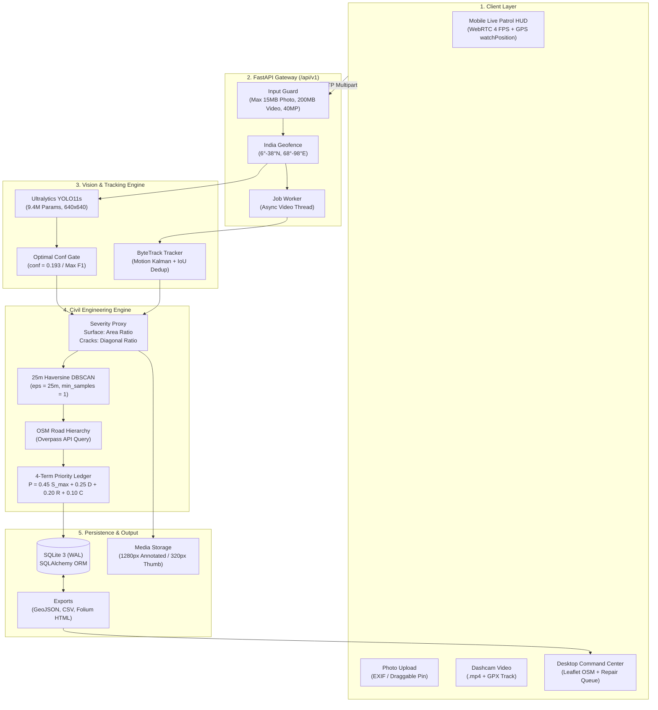

# Road Damage AI (`rdai`)
### AI-Based Indian Road Damage Detection, Severity Assessment & Geo-Mapped Maintenance Prioritization

[](https://python.org)
[](https://github.com/ultralytics/ultralytics)
[](https://fastapi.tiangolo.com)
[](tests/)
[](https://astral.sh/ruff)
[](LICENSE)

An end-to-end computer vision and civil engineering decision-support platform designed for Indian road networks. It converts uncurated smartphone snapshots, live patrol camera streams, and vehicle dashcam footage into an **auditable, ranked road repair dispatch queue**.

---

## 📖 Table of Contents
- [The Problem & The Solution](#-the-problem--the-solution)
- [How It Works (In Simple Terms)](#-how-it-works-in-simple-terms)
- [System Architecture](#-system-architecture)
- [Core Technical Pillars](#-core-technical-pillars)
  - [1. Detection & Multi-Object Video Tracking](#1-detection--multi-object-video-tracking)
  - [2. Class-Aware 2D Geometric Severity](#2-class-aware-2d-geometric-severity)
  - [3. 25-Meter Haversine DBSCAN Spatial Clustering](#3-25-meter-haversine-dbscan-spatial-clustering)
  - [4. Explainable 4-Term Priority Ledger](#4-explainable-4-term-priority-ledger)
- [Verified Benchmark Metrics](#-verified-benchmark-metrics)
- [Repository Structure](#-repository-structure)
- [Quickstart & Local Installation](#-quickstart--local-installation)
- [Training on Google Colab (AI Pro)](#-training-on-google-colab-ai-pro)
- [REST API Quick Reference](#-rest-api-quick-reference)
- [Documentation Index](#-documentation-index)
- [License & Attributions](#-license--attributions)

---

## 🚦 The Problem & The Solution

| The Reality on Indian Roads | How `rdai` Solves It |
| :--- | :--- |
| **Potholes & Monsoonal Wear:** Extreme monsoon rains cause rapid pavement deterioration, causing over $3,500$ fatal road accidents annually in India. | **Automated YOLO11s AI Detection:** Identifies potholes, alligator cracks, longitudinal cracks, and transverse cracks in **$1.28\text{ ms}$** on GPU. |
| **Slow, Dangerous Manual Surveys:** Field crews manually inspect roads walking in traffic with clipboards or subjective rating cards. | **Mobile Live Camera Patrol HUD:** Inspectors or vehicle patrol mounts capture real-time geocoded frames at $4\text{ FPS}$ with zero lag. |
| **Black-Box AI Models:** Conventional ML models output opaque "danger scores" ($0.87$) that civil engineers cannot justify for public budget expenditure. | **Explainable 4-Term Formula ($P$):** Every repair priority is backed by an auditable formula: $45\%$ Worst Severity $+$ $25\%$ Density $+$ $20\%$ Road Class $+$ $10\%$ Confidence. |
| **Duplicated Defect Counts in Video:** Driving past one pothole for 3 seconds generates 90 video frames of the exact same defect. | **ByteTrack Video Deduplication:** Employs Kalman filters and IoU matching to assign persistent track IDs, counting each physical defect once. |

---

## 💡 How It Works (In Simple Terms)

```
 [ Field Capture ] ──> [ YOLO11s AI ] ──> [ Severity Engine ] ──> [ 25m Clustering ] ──> [ Priority Ledger ]
  Phone / Dashcam       Detects 4 road      Calculates physical    Groups defects into     Ranks repair list
   + GPS Location       distress classes     extent (0 - 100)       road segments (DBSCAN)  (P = 0.45S + 0.25D...)
```

1. **Capture:** A field worker points a phone camera or uploads dashcam footage. GPS coordinates are automatically extracted from EXIF metadata, live browser geolocation, or GPX tracks.
2. **Detect:** A trained **YOLO11s** model spots damage boxes with confidence threshold gated at `0.193` (empirically chosen for maximum $F_1$).
3. **Grade Severity ($0 - 100$):** Potholes and alligator cracks are measured by surface area ratio; cracks are measured by diagonal span. They are assigned continuous scores and categorized into **Low**, **Medium**, or **High**.
4. **Cluster into 25m Segments:** Rather than sending work crews to individual GPS dots, nearby defects within 25 meters are grouped into contiguous road segments using Haversine DBSCAN.
5. **Prioritize Repairs:** Segments are ranked on an interactive map and triage table so municipalities fix the most dangerous highways first.

---

## 🏗 System Architecture

The system uses a modular, decoupled architecture spanning mobile/desktop clients, a high-performance **FastAPI** gateway, an inference/tracking engine, civil engineering mathematical rules, and **SQLite (WAL mode)** persistence.

An interactive vector diagram is available at **[docs/architecture_diagram.svg](docs/architecture_diagram.svg)**:



> 📖 **Deep Technical Dive:** Read the complete [System Architecture Specification](docs/ARCHITECTURE.md).

---

## ⚙️ Core Technical Pillars

### 1. Detection & Multi-Object Video Tracking
- **Detector:** `YOLO11s` with C3k2 convolutional blocks, SPPF, and C2PSA pointwise spatial attention.
- **Model Size:** 9.4 Million parameters ($35.3\text{ GFLOPs}$).
- **4 Standard Distress Classes:**
  - `0: D00` — Longitudinal crack
  - `1: D10` — Transverse crack
  - `2: D20` — Alligator (structural fatigue) crack
  - `3: D40` — Pothole
- **Optimal Operating Gate:** Calibrated at **`optimal_conf = 0.193`** on the validation precision-recall curve to maximize harmonic $F_1$ score ($0.3401$).
- **Video Deduplication:** Employs **ByteTrack** to maintain persistent `track_id` state across video frames, eliminating multi-frame defect overcounting.

### 2. Class-Aware 2D Geometric Severity
Without expensive LiDAR/3D sensors, `rdai` maps monocular bounding boxes into physical pavement distress:

1. **Surface Loss Defects (`D40` Pothole, `D20` Alligator):**
   $$e_{\text{area}} = \frac{w_{\text{box}} \times h_{\text{box}}}{W_{\text{img}} \times H_{\text{img}}}$$
2. **Linear Structural Cracks (`D00` Longitudinal, `D10` Transverse):**
   $$e_{\text{diag}} = \frac{\sqrt{w_{\text{box}}^2 + h_{\text{box}}^2}}{\sqrt{W_{\text{img}}^2 + H_{\text{img}}^2}}$$
3. **Continuous Score Mapping ($0 - 100$):**
   Piece-wise linear interpolation between domain thresholds in `configs/severity.yaml`:
   - **Low:** $S \in [0.0, 33.3)$
   - **Medium:** $S \in [33.3, 66.7)$
   - **High:** $S \in [66.7, 100.0]$
   - *Structural Safety Rule:* Alligator cracking (`D20`) has an automatic floor of `Medium` ($S \ge 33.3$) to flag base-course degradation.

### 3. 25-Meter Haversine DBSCAN Spatial Clustering
- Uses the spherical **Haversine formula** ($R = 6,371,000\text{ m}$) to measure geodesic surface distance between defect coordinates.
- Clusters detections with $\varepsilon = 25.0\text{ meters}$ and $\text{min\_samples} = 1$.
- Calculates geographic centroids $(\bar{\phi}, \bar{\lambda})$ as the official dispatch coordinate for municipal maintenance crews.

### 4. Explainable 4-Term Priority Ledger
Every prioritized road segment displays its mathematical derivation:

$$\mathbf{P = 0.45 \, S_{\max} + 0.25 \, D + 0.20 \, R + 0.10 \, C}$$

- **$S_{\max} \in [0, 100]$ (45% weight):** The single worst defect severity in the cluster.
- **$D \in [0, 100]$ (25% weight):** Defect density, saturated at 10 defects ($D = 100 \times \min(N / 10, 1.0)$).
- **$R \in [35, 100]$ (20% weight):** OpenStreetMap road hierarchy:
  - Motorway / Trunk: `100` | Primary: `85` | Secondary: `70` | Tertiary: `55` | Residential: `35`
- **$C \in [0, 100]$ (10% weight):** Mean detector confidence ($100 \times \bar{c}$).

> 📖 **Deep Mathematical Details:** Read the full [Civil Engineering Severity & Priority Guide](docs/SEVERITY_AND_PRIORITY.md).

---

## 📊 Verified Benchmark Metrics

Per project guidelines, all reported metrics come directly from `reports/metrics.json` evaluated on the held-out **`RDD2022` India test split** ($1,156$ images in non-leaking 50-block corridors; optimal confidence $= 0.193$):

| Class | Category | Precision | Recall | AP@50 | AP@50:95 |
| :--- | :--- | :---: | :---: | :---: | :---: |
| **`D00`** | Longitudinal Crack | `0.3223` | `0.2295` | `0.2409` | `0.1243` |
| **`D10`** | Transverse Crack | `0.4316` | `0.1538` | `0.2221` | `0.1046` |
| **`D20`** | Alligator Crack | `0.5443` | `0.6073` | **`0.5885`** | `0.2921` |
| **`D40`** | Pothole | `0.4964` | `0.3963` | **`0.4105`** | `0.1701` |
| **all** | **4-Class Macro Average** | **`0.4487`** | **`0.3467`** | **`0.3655`** | **`0.1728`** |

### Execution Speed & Stability
- **Inference Latency (NVIDIA A100 GPU):** **$1.28\text{ ms / frame}$** ($>750\text{ FPS}$)
- **Inference Latency (Multi-Core CPU):** **$151.71\text{ ms / frame}$** ($\approx 6.6\text{ FPS}$)
- **Rank Stability (Sensitivity Analysis):** Spearman $\rho = \mathbf{1.000}$ across $\pm 20\%$ perturbations of all ledger weights.

> 📖 **Full ML Pipeline & Discussion:** Read [Machine Learning & Data Pipeline](docs/PIPELINE.md) and [Model Card](docs/model_card.md).

---

## 📂 Repository Structure

```
├── configs/                  # Thresholds & parameters (NEVER hardcoded in code)
│   ├── app.yaml              # API ports, geofencing bbox, upload limits, CORS
│   ├── data.yaml             # YOLO dataset paths & class definitions
│   ├── priority.yaml         # Clustering radius (25m), formula weights, OSM scores
│   ├── severity.yaml         # Geometric thresholds (e_low, e_high) & tier bounds
│   └── train.yaml            # Hyperparameters, batch sizes, 50-block split rules
├── docs/                     # Project technical documentation
│   ├── architecture_diagram.svg # Vector architecture diagram
│   ├── ARCHITECTURE.md       # Detailed technical architecture specification
│   ├── PIPELINE.md           # Data processing, non-leaking split, & ML training
│   ├── SEVERITY_AND_PRIORITY.md # Civil engineering math, IRC context, & formulas
│   ├── API.md                # Complete REST API reference with cURL examples
│   ├── model_card.md         # Formal ML Model Card & audit disclosures
│   └── PRD.md                # Master Product Requirements Document
├── frontend/                 # Field survey frontend (React 18 + Vite + Leaflet)
│   ├── src/views/LiveHud.tsx # WebRTC Live Camera Patrol HUD with canvas overlay
│   ├── src/views/MapView.tsx # Interactive OpenStreetMap 25m segment visualizer
│   └── src/views/QueueView.tsx # Ranked repair queue with 4-term ledger breakdown
├── reports/                  # Evaluation outputs (Single Source of Truth)
│   ├── metrics.json          # Verified test split evaluation metrics
│   ├── figures/              # Confusion matrix, PR curves, F1 curves
│   └── tables/               # Weight sensitivity, ablations, top segments
├── runs/e1_yolo11s_640/      # Trained model weights (best.pt and best.onnx)
├── src/rdai/                 # Core Python backend source
│   ├── api/                  # FastAPI router, schemas, and upload safety guards
│   ├── data/                 # VOC to YOLO conversion, 50-block splitting, EDA
│   ├── db/                   # SQLite models (images, detections, segments, jobs)
│   ├── geo/                  # Haversine distance, DBSCAN, OSM Overpass resolver
│   ├── inference/            # Ultralytics detector & ByteTrack tracker
│   ├── priority/             # 4-term maintenance prioritization ledger
│   ├── severity/             # Class-aware 2D geometric severity calculator
│   └── train/                # Training routines and held-out evaluation
└── tests/                    # Pytest suite (91 fast tests, unit/api/security/model)
```

---

## 🚀 Quickstart & Local Installation

### Prerequisites
- Python 3.11+
- Node.js 18+ (for frontend)
- Git & Make

### 1. Clone & Set Up Virtual Environment
```bash
# Clone the repository
git clone https://github.com/your-username/road-damage-ai.git
cd road-damage-ai

# Initialize virtualenv, install dependencies, and generate test fixtures
make setup
```

### 2. Run Test Suite & Linter
```bash
# Run 91 fast unit, integration, API, and security tests
make test

# Verify code style with Ruff
make lint
```

### 3. Launch the Backend API Server
```bash
# Starts FastAPI server on http://localhost:8000
make run
```
* Interactive Swagger UI: `http://localhost:8000/docs`
* API Health Check: `http://localhost:8000/api/v1/health`

### 4. Launch the Frontend
```bash
cd frontend
npm install
npm run dev
```
Open `http://localhost:5173` in your browser. For mobile inspection, connect your phone to the same Wi-Fi network and open your machine's local IP.

---

## ☁️ Training on Google Colab (AI Pro)

To train YOLO11s from scratch using a **Google AI Pro** GPU runtime:

1. **Select Runtime:** In Google Colab, go to `Runtime` $\rightarrow$ `Change runtime type` $\rightarrow$ select **A100** or **L4 GPU**.
2. **Mount Project or Drive:**
   ```python
   from google.colab import drive
   drive.mount('/content/drive')
   %cd "/content/drive/MyDrive/road-damage-ai"
   ```
3. **Install Dependencies:**
   ```bash
   !pip install -q ultralytics pyyaml
   ```
4. **Prepare Dataset & Train:**
   ```bash
   # Run 50-block non-leaking split
   !python -m rdai.data.split
   
   # Launch YOLO11s 150-epoch training recipe (E1)
   !python -m rdai.train.train
   ```
5. **Evaluate on Held-Out Test Split:**
   ```bash
   !python -m rdai.train.evaluate
   ```

---

## 🔌 REST API Quick Reference

| Method | Endpoint | Description |
| :--- | :--- | :--- |
| `GET` | `/api/v1/health` | Model status, loaded checkpoint, GPU/CPU device, and optimal confidence |
| `POST` | `/api/v1/detect/image` | Single photo upload + GPS coordinates $\rightarrow$ detections & 25m segment |
| `POST` | `/api/v1/detect/video` | Dashcam video upload + GPX track $\rightarrow$ async background job with ByteTrack |
| `GET` | `/api/v1/jobs/{job_id}` | Polling video processing progress and deduplicated track summary |
| `GET` | `/api/v1/segments` | Ranked 25m road repair queue ordered by Priority Score ($P$) |
| `PATCH` | `/api/v1/segments/{id}/status` | Work-order lifecycle transitions (`new` $\rightarrow$ `verified` $\rightarrow$ `scheduled` $\rightarrow$ `fixed`) |
| `GET` | `/api/v1/map/geojson` | RFC 7946 GeoJSON feature collection for interactive map rendering |
| `GET` | `/api/v1/export/csv` | Download full maintenance repair queue as a CSV spreadsheet |
| `GET` | `/api/v1/metrics` | Programmatic access to verified benchmark results (`metrics.json`) |

> 📖 **Complete API Reference:** Read the [REST API Specification](docs/API.md).

---

## 📚 Documentation Index

- **[System Architecture](docs/ARCHITECTURE.md):** Detailed technical breakdown of all subsystems, security guards, data flow, and database schema.
- **[Architecture Diagram (SVG)](docs/architecture_diagram.svg):** Standalone vector architecture graphic.
- **[ML & Data Pipeline](docs/PIPELINE.md):** RDD2022 India dataset, 50-block non-leaking split, training hyperparameters, and quantitative evaluation.
- **[Civil Engineering Severity & Priority](docs/SEVERITY_AND_PRIORITY.md):** IRC pavement distress context, 2D geometric proxies, DBSCAN clustering, and 4-term ledger derivation.
- **[REST API Guide](docs/API.md):** Full documentation for all `/api/v1` routes with request/response schemas and cURL examples.
- **[Model Card](docs/model_card.md):** Formal ML model card detailing intended use, quantitative performance, and known limitations.
- **[Product Requirements Document (PRD)](docs/PRD.md):** Master product blueprint, functional requirements, and rubric mapping.

---

## 📄 License & Attributions

- **Codebase License:** Source code and YOLO11 integration follow **AGPL-3.0** ([LICENSE](LICENSE)).
- **Third-Party Attributions:** Reused architectural concepts, permitted test utilities, and open-source packages are documented in [NOTICE.md](NOTICE.md).
- **Map Tiles:** © [OpenStreetMap](https://www.openstreetmap.org/copyright) contributors under ODbL.
- **Dataset Attribution:** Arya et al. (2022), *RDD2022: A multi-national image dataset for automatic Road Damage Detection*.
