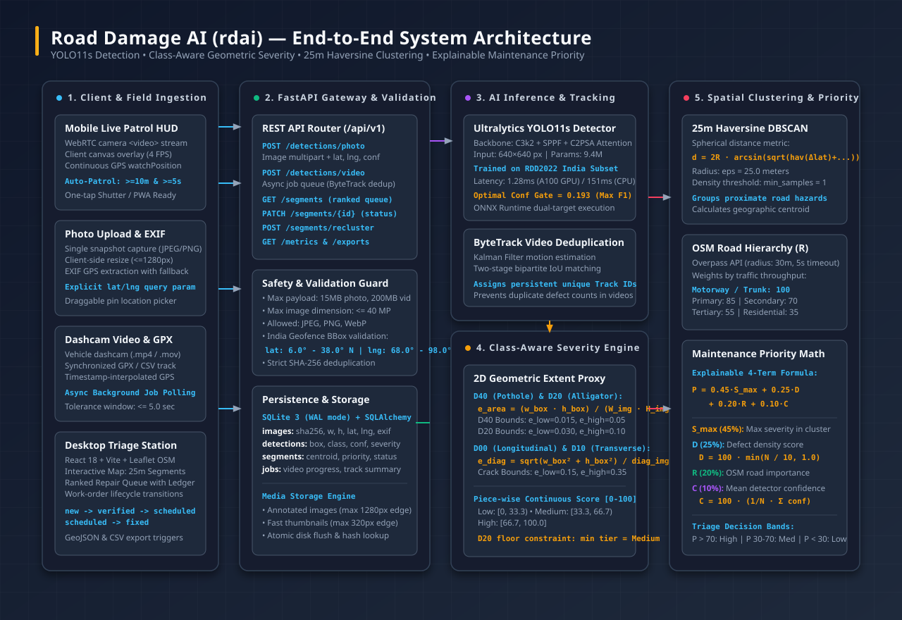
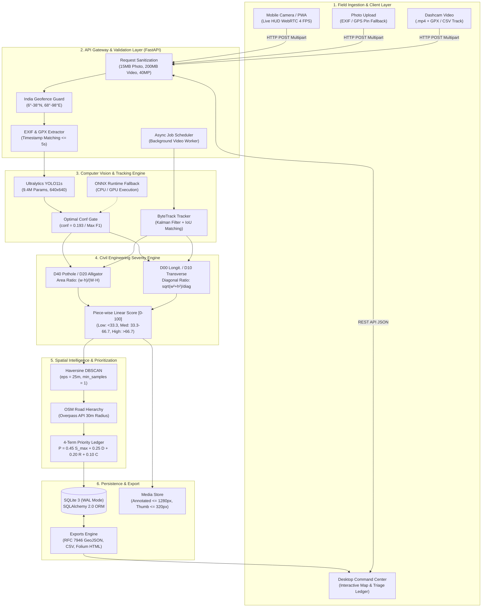
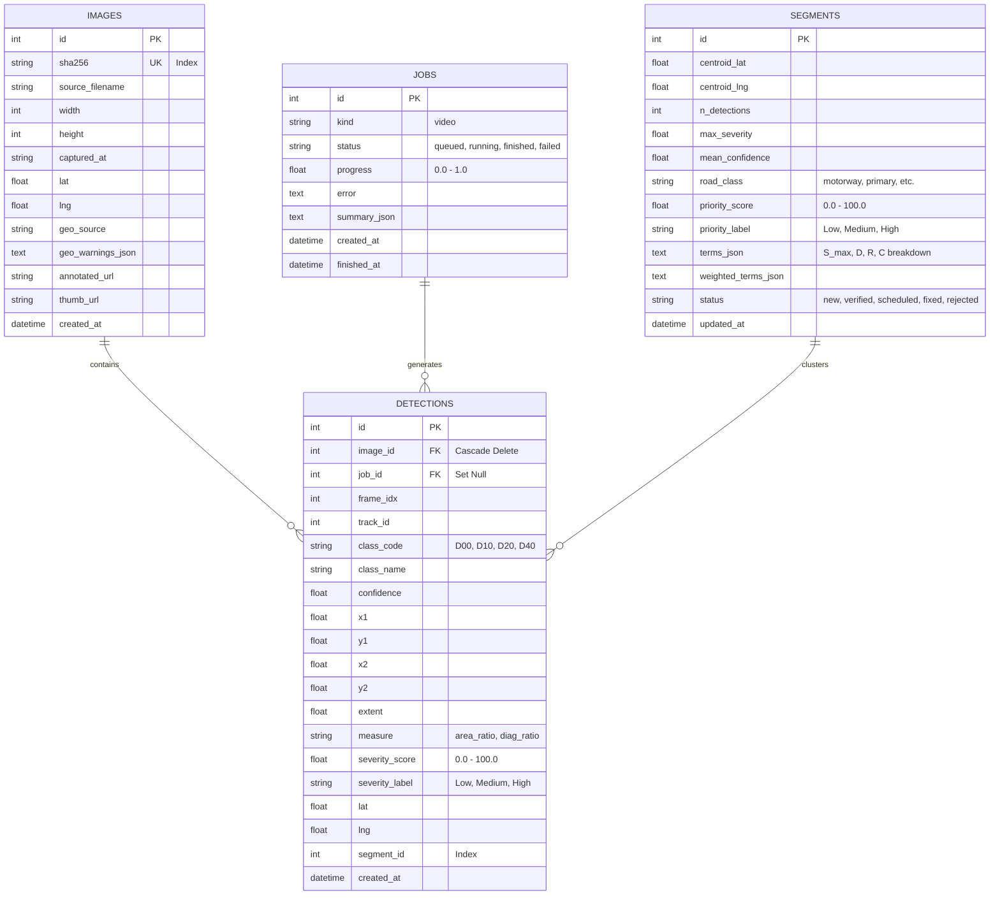
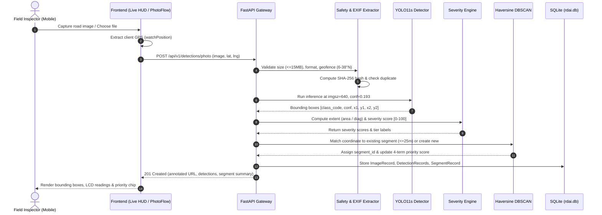
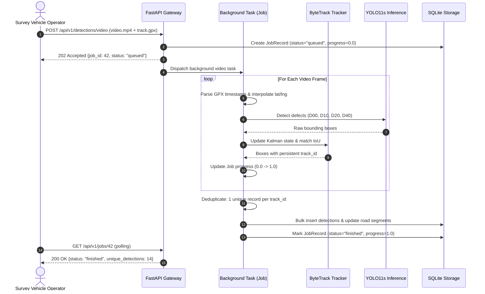

# System Architecture — Road Damage AI (`rdai`)

## 1. Executive Summary & Architecture Philosophy

**Road Damage AI (`rdai`)** is an automated, end-to-end computer vision and civil engineering decision-support platform designed specifically for Indian road networks. It transforms uncurated smartphone captures, live camera patrol streams, and vehicle dashcam footage into an auditable, geolocated, and ranked road repair schedule.

### Core Architecture Principles

1. **No Black-Box Metrics:** Unlike conventional ML prototypes that output opaque risk scores, every decision in `rdai` is backed by an explicit four-term civil engineering formula ($P = 0.45 S_{\max} + 0.25 D + 0.20 R + 0.10 C$) and verified quantitative evaluation records (`reports/metrics.json`).
2. **Class-Aware Geometric Grounding:** Damage severity is computed using domain-informed 2D geometric proxies (area ratios for surface loss like potholes and alligator cracks; diagonal ratios for linear structural fractures like longitudinal and transverse cracks).
3. **Spatial Granularity (25-Meter Segments):** Potholes and cracks are clustered into actionable 25-meter road segments using the spherical Haversine distance metric and DBSCAN clustering, matching the operational repair dispatch units of Indian municipal road authorities (e.g., PWD, NHAI).
4. **Field-Ready Under Glare and Motion:** The client architecture is optimized for mobile field inspection under direct sunlight (high-contrast surveyor palette, WebRTC Live Patrol HUD with real-time bounding box canvas overlay, and client-side GPS pinning).

---

## 2. High-Level Architecture Diagram

The system follows a multi-tier modular architecture spanning client devices, API gateway, computer vision inference, civil engineering rules, spatial clustering, and transactional storage.

An interactive vector diagram is maintained at [docs/architecture_diagram.svg](architecture_diagram.svg).

### End-to-End Component Flow (Mermaid)

---

## 3. Subsystem Breakdown & Technical Details

### 3.1. Client & Ingestion Subsystem

The client layer supports three operational modes tailored for Indian municipal field workers and engineers:

1. **Mobile Live Camera Patrol HUD (`LiveHud.tsx`):**
   - Implemented via HTML5 WebRTC `<video>` stream connected to the rear camera (`facingMode: "environment"`).
   - Captures frames at 4 FPS, rendering detection bounding boxes on an overlaid `<canvas>` with zero perceived lag.
   - Continuously queries `navigator.geolocation.watchPosition` with high accuracy.
   - **Auto-Patrol Logging:** Automatically records a new geotagged inspection when the vehicle or inspector moves $\ge 10\text{ meters}$ and at least $5\text{ seconds}$ have elapsed since the prior capture.
2. **Single Photo Upload (`PhotoFlow.tsx`):**
   - Supports user-submitted smartphone images (up to 15MB, 40 Megapixels).
   - Client-side pre-scaling preserves bandwidth while keeping image resolution optimal for 640px inference.
   - EXIF parser extracts GPS latitude, longitude, and timestamp; if EXIF is missing or wiped by social platforms, a draggable OpenStreetMap pin picker provides an intuitive fallback.
3. **Dashcam Video & GPX Track Upload (`VideoFlow.tsx`):**
   - Accepts vehicle dashcam files (`.mp4`, `.mov`, `.avi`, up to 200MB) coupled with GPX or CSV track logs.
   - The backend matches video frame indices to GPS coordinates by interpolating between track timestamps within a 5.0-second tolerance window.
4. **Desktop Command Center & Triage View (`QueueView.tsx`, `MapView.tsx`):**
   - Interactive Leaflet map displaying 25-meter road segment centroids colored by priority tier (High: Red, Medium: Amber, Low: Emerald).
   - Ranked repair queue with expandable 4-term ledger breakdowns and status update triggers (`new` $\rightarrow$ `verified` $\rightarrow$ `scheduled` $\rightarrow$ `fixed` or `rejected`).

---

### 3.2. API Gateway & Validation Layer (`src/rdai/api/`)

Built on **FastAPI** with Pydantic v2 schemas and strict asynchronous endpoint handlers:

* **Upload Limits & Constraints (`configs/app.yaml`):**
  - Maximum photo payload: $15\text{ MB}$.
  - Maximum video payload: $200\text{ MB}$.
  - Image dimension ceiling: $40\text{ Megapixels}$ (prevents decompression bomb attacks).
  - Allowed MIME formats: `image/jpeg`, `image/png`, `image/webp`.
* **Geofence Enforcement:** Coordinates must lie within the bounding box of India:
  $$\text{Latitude} \in [6.0^\circ\text{N}, 38.0^\circ\text{N}], \quad \text{Longitude} \in [68.0^\circ\text{E}, 98.0^\circ\text{E}]$$
* **Deduplication:** Uploaded images are hashed via SHA-256. Duplicate submissions instantly resolve to existing database records, preventing redundant compute.
* **Asynchronous Jobs (`JobRecord`):** Long-running video inference runs in a background thread pool, exposing progress tracking (`0.0` to `1.0`), error states, and result summaries via `GET /api/v1/jobs/{id}`.

---

### 3.3. AI Inference & Video Tracking Engine (`src/rdai/inference/`)

#### Detector Architecture: Ultralytics YOLO11s
- **Backbone & Neck:** Uses Ultralytics YOLO11s architecture with `C3k2` (cross-stage partial blocks with kernel size 2), Spatial Pyramid Pooling Fast (`SPPF`), and `C2PSA` (Cross-Stage Partial with Pointwise Spatial Attention) neck modules for enhanced multi-scale feature representation.
- **Model Size:** 9.4 Million parameters ($35.3\text{ GFLOPs}$ at $640 \times 640\text{ px}$).
- **Target Classes:**
  - `0: D00` — Longitudinal crack
  - `1: D10` — Transverse crack
  - `2: D20` — Alligator (fatigue) crack
  - `3: D40` — Pothole
- **Optimal Confidence Thresholding:**
  Rather than using an arbitrary default like 0.25 or 0.50, the inference engine gates detections at **`optimal_conf = 0.193`**, which was empirically determined on the held-out validation curve to maximize the $F_1$ score ($F_1 = 0.3401$).
- **Inference Latency:**
  - NVIDIA A100 GPU: **$1.28\text{ ms/image}$**
  - CPU Benchmark: **$151.71\text{ ms/image}$**
- **Dual Execution Engine:**
  Native PyTorch execution via Ultralytics with automatic fallback to **ONNX Runtime** (`runs/e1_yolo11s_640/weights/best.onnx`) for environments without a PyTorch CUDA toolchain.

#### Multi-Object Tracking: ByteTrack
When processing video sequences, adjacent frames often contain multiple views of the exact same pothole. Counting every bounding box would drastically distort segment density.
- **ByteTrack Integration:** Tracks objects across frames by associating both high-confidence and low-confidence detection boxes using Kalman Filter velocity prediction and spatial Intersection over Union (IoU) matching.
- **Deduplication:** Assigns persistent `track_id` integers. When calculating road segment defect density, detections sharing the same `track_id` in a video run are counted as a single physical defect instance.

---

### 3.4. Civil Engineering Severity Grading Engine (`src/rdai/severity/`)

Road damage severity is not a generic classification label; it must reflect physical dimensions relative to vehicular safety and structural pavement degradation per **Indian Roads Congress (IRC)** guidelines.

Because single-camera monocular vision lacks direct depth/LiDAR point clouds, `rdai` implements a **class-aware 2D geometric proxy**:

#### 1. Surface Loss Defects (`D40` Pothole & `D20` Alligator Crack)
Severity is proportional to damaged pavement surface area:
$$e_{\text{area}} = \frac{w_{\text{box}} \times h_{\text{box}}}{W_{\text{img}} \times H_{\text{img}}}$$

#### 2. Linear Structural Cracks (`D00` Longitudinal & `D10` Transverse)
Severity is proportional to crack length across the field of view:
$$e_{\text{diag}} = \frac{\sqrt{w_{\text{box}}^2 + h_{\text{box}}^2}}{\sqrt{W_{\text{img}}^2 + H_{\text{img}}^2}}$$

#### Continuous Score Mapping ($0 - 100$)
Using domain thresholds defined in `configs/severity.yaml`:

| Damage Class | Measure | $e_{\text{low}}$ | $e_{\text{high}}$ | Minimum Tier Constraint |
| :--- | :--- | :---: | :---: | :---: |
| **`D40` Pothole** | Area Ratio | `0.015` ($1.5\%$) | `0.050` ($5.0\%$) | Low |
| **`D20` Alligator Crack** | Area Ratio | `0.030` ($3.0\%$) | `0.100` ($10.0\%$) | **Medium** (Structural failure) |
| **`D00` Longitudinal Crack** | Diagonal Ratio | `0.150` ($15\%$) | `0.350` ($35\%$) | Low |
| **`D10` Transverse Crack** | Diagonal Ratio | `0.150` ($15\%$) | `0.350` ($35\%$) | Low |

The score $S$ is computed through piece-wise linear interpolation:
$$S(e) = \begin{cases}
\frac{e}{e_{\text{low}}} \times 33.3, & e \le e_{\text{low}} \\
33.3 + \frac{e - e_{\text{low}}}{e_{\text{high}} - e_{\text{low}}} \times (66.7 - 33.3), & e_{\text{low}} < e \le e_{\text{high}} \\
66.7 + \min\left(1.0, \frac{e - e_{\text{high}}}{e_{\text{high}}}\right) \times (100.0 - 66.7), & e > e_{\text{high}}
\end{cases}$$

- **Severity Tiers:**
  - **Low:** $S \in [0.0, 33.3)$
  - **Medium:** $S \in [33.3, 66.7)$
  - **High:** $S \in [66.7, 100.0]$
- **Engineering Safety Floor:** Alligator cracking (`D20`) signifies base-course structural fatigue. Per `configs/severity.yaml`, its minimum severity is clamped to `Medium` ($S \ge 33.3$).

---

### 3.5. Spatial Intelligence & Prioritization Subsystem (`src/rdai/geo/`, `src/rdai/priority/`)

#### 1. 25-Meter Haversine DBSCAN Clustering
Instead of treating each detection in isolation, defects are grouped into coherent road sections:
- **Haversine Distance Metric:** Accounts for spherical Earth curvature:
  $$d(\mathbf{x}_1, \mathbf{x}_2) = 2 R_{\text{earth}} \arcsin \left(\sqrt{\sin^2\left(\frac{\Delta \phi}{2}\right) + \cos \phi_1 \cos \phi_2 \sin^2\left(\frac{\Delta \lambda}{2}\right)}\right)$$
  where $R_{\text{earth}} = 6,371,000\text{ meters}$.
- **Parameters (`configs/priority.yaml`):**
  - $\varepsilon = 25.0\text{ meters}$ (maximum cluster radius).
  - $\text{min\_samples} = 1$ (every single defect forms or belongs to a segment).
- **Centroid Calculation:** The geographic centroid $(\bar{\phi}, \bar{\lambda})$ of all member detections forms the permanent anchor of the road segment.

#### 2. OpenStreetMap Road Hierarchy Weighting ($R$)
Using the Overpass API (with a 30m query radius and 5s timeout, caching results), the system resolves the underlying OpenStreetMap highway classification:

| OpenStreetMap Highway Tag | Importance Score ($R$) | Rationale |
| :--- | :---: | :--- |
| `motorway`, `trunk` | **`100`** | High-speed, high-density national corridors (NHAI) |
| `primary` | **`85`** | State highways connecting major economic centers |
| `secondary` | **`70`** | Major district roads (MDR) connecting towns |
| `tertiary` | **`55`** | Other district roads (ODR) |
| `residential`, `unclassified` | **`35`** | Low-speed municipal colony roads |
| `unknown` (fallback) | **`50`** | Default when offline or outside OSM road vectors |

#### 3. Four-Term Maintenance Priority Formula
The final priority score $P \in [0, 100]$ for each 25-meter road segment is computed via an explicit, auditable linear combination:

$$P = w_1 S_{\max} + w_2 D + w_3 R + w_4 C$$

Substituting the calibrated weights from `configs/priority.yaml`:

$$\mathbf{P = 0.45 \, S_{\max} + 0.25 \, D + 0.20 \, R + 0.10 \, C}$$

Where:
1. **$S_{\max} \in [0, 100]$ (45% weight):** The highest single defect severity score among all detections in the segment cluster. (A single catastrophic 80-score pothole demands immediate patch dispatch).
2. **$D \in [0, 100]$ (25% weight):** Defect density score. Linear saturation function capping at 10 defects per 25 meters:
   $$D = 100 \times \min\left(\frac{N_{\text{unique}}}{10}, 1.0\right)$$
3. **$R \in [35, 100]$ (20% weight):** Road network classification score resolved from OpenStreetMap.
4. **$C \in [0, 100]$ (10% weight):** Mean detector confidence for detections in the segment ($C = 100 \times \bar{c}$), ensuring high-confidence clusters rank slightly higher than borderline noisy detections.

#### Triage Action Bands:
- **High Priority ($P > 70.0$):** Emergency repair dispatch (potholes on national/state highways or severe alligator clusters).
- **Medium Priority ($30.0 \le P \le 70.0$):** Scheduled maintenance work orders.
- **Low Priority ($P < 30.0$):** Routine monitoring and observation.

---

### 3.6. Persistence & Storage Architecture (`src/rdai/db/`)

The persistence tier uses **SQLite 3** operating in **Write-Ahead Logging (WAL)** mode via **SQLAlchemy 2.0** ORM.

#### Schema Entity-Relationship Diagram (Mermaid)

#### State Machine for Work-Orders
Segments enforce strict lifecycle state transitions:
$$\text{new} \longrightarrow \{\text{verified}, \text{rejected}\}$$
$$\text{verified} \longrightarrow \{\text{scheduled}, \text{rejected}\}$$
$$\text{scheduled} \longrightarrow \{\text{fixed}\}$$

---

## 4. End-to-End Sequence Diagrams

### 4.1. Single Photo Ingestion & Triage Workflow

### 4.2. Video Processing with ByteTrack & GPX Synchronization

---

## 5. Security, Resilience & Non-Functional Architecture

1. **Decompression Bomb Protection:** Pillow's image limit is guarded against arbitrary high-megapixel payload attacks (`max_megapixels = 40`).
2. **Indian Territory Coordinate Geofencing:** Prevents GPS spoofing or foreign data injection into Indian municipality ledgers.
3. **Resilient OpenStreetMap Integration:**
   - Overpass API calls run with strict 5-second timeouts.
   - If Overpass is unreachable or throttled, road importance gracefully defaults to `R = 50` (`unknown`) without failing the inspection transaction.
4. **Deterministic Auditing:** Model weights and evaluation metrics are completely isolated from source code. Every number shown in the user interface originates strictly from `reports/metrics.json`.
