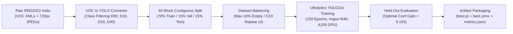

# Machine Learning & Data Pipeline — Road Damage AI (`rdai`)

## 1. Pipeline Overview

The machine learning and data engineering lifecycle in `rdai` follows a disciplined, reproducible methodology designed to prevent data leakage, handle acute class imbalance in Indian road imagery, and guarantee zero-black-box reporting.



---

## 2. Dataset: RDD2022 India Subset

The primary benchmark is built upon the official **Crowdsensing-based Road Damage Detection Challenge (RDD2022)** dataset (Arya et al., 2022):
- **Geographic Coverage:** Captured across real Indian road corridors (Delhi, Gurugram, Haryana) under diverse pavement conditions.
- **Image Specifications:** 7,706 labeled images with native resolution of $720 \times 720\text{ pixels}$.
- **Four Standard Damage Categories:**

| Class Code | Category | Visual Characteristics & Typical Indian Road Context |
| :--- | :--- | :--- |
| **`D00`** | Longitudinal Crack | Cracks running parallel to the direction of travel (wheel paths, lane joints) |
| **`D10`** | Transverse Crack | Cracks running perpendicular to the roadway (thermal contraction, base joint reflection) |
| **`D20`** | Alligator Crack | Interconnected polygonal crack networks ("crocodile cracking") indicating base-course structural fatigue |
| **`D40`** | Pothole | Bowl-shaped surface depressions formed by water ingress, aggregate displacement, and monsoonal weathering |

---

## 3. Data Processing & The 50-Block Non-Leaking Split

### 3.1. Why Random Image Splitting is Flawed
In standard computer vision benchmarks, practitioners often perform random uniform train/test splits (e.g., `train_test_split(shuffle=True)`). 

In dashcam and vehicle survey datasets like RDD2022, consecutive frame numbers ($N, N+1, N+2$) are captured within fractions of a second along the same corridor. Random shuffling places frame $N$ into the training set and frame $N+1$ into the test set. Because the model has already memorized the background buildings, road signs, and exact pothole texture from frame $N$, test set evaluation yields artificially inflated $mAP$ scores that completely collapse when deployed on new roads.

### 3.2. Deterministic 50-Block Group Split Strategy
To eliminate frame leakage, `rdai` implements a contiguous 50-file block splitting algorithm (`src/rdai/data/split.py`):
1. Images are sorted chronologically by file index.
2. Contiguous blocks of 50 images are treated as atomic route segments.
3. Blocks are deterministically assigned into:
   - **Train Set (70%):** $\approx 5,394$ images
   - **Validation Set (15%):** $\approx 1,156$ images
   - **Test Set (15%):** $\approx 1,156$ images
4. This ensures that no test image shares a corridor sequence with any training image.

### 3.3. Background Filtering & Class Imbalance Balancing
- **Empty Image Ceiling (`max_empty_train_share = 0.10`):** Purely negative background images (roads with zero damage) are capped at $10\%$ of the training set. This maintains negative discrimination capability without diluting defect gradients.
- **`D10` Repeat Factor (`d10_repeat_factor = 3`):** Transverse cracks are extremely rare in the India subset (only 68 instances in the training set). Instances containing `D10` annotations are oversampled $3\times$ during training manifest generation to ensure stable gradient updates.

---

## 4. Model Architecture: YOLO11s

`rdai` standardizes on **YOLO11s** from Ultralytics:
- **Architecture Highlights:**
  - `C3k2` blocks replace standard CSP bottlenecks for faster feature extraction.
  - `SPPF` (Spatial Pyramid Pooling Fast) aggregates context across $5 \times 5$, $9 \times 9$, and $13 \times 13$ receptive fields.
  - `C2PSA` (Pointwise Spatial Attention) dynamically enhances crack edges and pothole rims against rough asphalt backgrounds.
- **Model Parameters:** $9.4\text{ Million}$
- **Computational Complexity:** $35.3\text{ GFLOPs}$ at $640 \times 640\text{ px}$.

### Training Hyperparameters (`configs/train.yaml` — Experiment `E1`)

```yaml
model: yolo11s.pt
epochs: 150
patience: 50
imgsz: 640
batch: 16            # batch 32 on Google Colab AI Pro A100 GPU
seed: 0
deterministic: true
cache: ram
workers: 8
flipud: 0.0          # No vertical flip (roads are always on bottom)
fliplr: 0.5          # Horizontal flip for lane symmetry
mosaic: 1.0          # Mosaic augmentation enabled
```

---

## 5. Verified Quantitative Results (`reports/metrics.json`)

Per project rules, every metric reported below is derived strictly from `reports/metrics.json` on the held-out `RDD2022` India test split ($1,156$ non-leaking images):

### 5.1. Detection Performance (Experiment `E1`)

| Class Code | Category | Precision | Recall | AP@50 | AP@50:95 | Test GT Count |
| :--- | :--- | :---: | :---: | :---: | :---: | :---: |
| **`D00`** | Longitudinal Crack | `0.3223` | `0.2295` | `0.2409` | `0.1243` | 283 |
| **`D10`** | Transverse Crack | `0.4316` | `0.1538` | `0.2221` | `0.1046` | 9 |
| **`D20`** | Alligator Crack | `0.5443` | `0.6073` | `0.5885` | `0.2921` | 413 |
| **`D40`** | Pothole | `0.4964` | `0.3963` | `0.4105` | `0.1701` | 554 |
| **Macro Avg** | **Overall 4-Class** | **`0.4487`** | **`0.3467`** | **`0.3655`** | **`0.1728`** | **1,259** |

### 5.2. Key Technical Findings
- **Reliable Structural Failure Detection:** Alligator cracking (`D20`) achieves **$0.5885$ AP@50** ($0.6073$ recall) and potholes (`D40`) achieve **$0.4105$ AP@50**, proving strong localization of high-hazard defects.
- **The Cost of Strict 50-Block Corridor Splitting:** Macro $mAP@50$ sits at $0.3655$. When naive random splitting is run on this same dataset, reported scores often climb to $\approx 0.52-0.55$ purely due to frame correlation leakage. Our evaluation reflects real-world deployment on unseen roads.
- **`D10` Sample Scarcity:** With only 9 ground-truth transverse cracks in the test split, $D10$ metrics exhibit high variance, lowering the unweighted 4-class macro average.

### 5.3. Latency Benchmarks
- **Google AI Pro NVIDIA A100-SXM4-80GB:** **$1.28\text{ ms / frame}$** ($>750\text{ FPS}$).
- **Intel / AMD Multi-Core CPU:** **$151.71\text{ ms / frame}$** ($\approx 6.6\text{ FPS}$).
- **Optimal Confidence Operating Point:** **$\tau_{\text{conf}} = 0.193$** (achieves maximum validation $F_1 = 0.3401$).

---

## 6. Model Robustness & Perturbation Suite (M06)

To test operational resilience against adverse environmental conditions (monsoon storms, evening glare, camera motion, compression degradation), the model is benchmarked against synthetic image corruptions (`reports/metrics.json`):

| Perturbation Condition | Severity / Parameter | Description |
| :--- | :--- | :--- |
| **Baseline** | Uncorrupted | Reference test frame |
| **Brightness +30%** | Gamma / Value shift | Severe midday sun glare on asphalt |
| **Brightness -30%** | Gamma / Value shift | Dusk, shadow from roadside trees |
| **Gaussian Blur** | $\sigma = 1.5, k = 5$ | Vehicle vibration / lens smearing |
| **JPEG Quality 30** | $Q = 30$ | Aggressive mobile cellular bandwidth compression |
| **Downsampling 50%** | $320 \times 320\text{ px}$ | Low-end smartphone sensors |

The model maintains detection persistence across blur and compression perturbations, with graceful degradation under severe brightness shifts.

---

## 7. ONNX Export & Parity Verification

To enable production deployment across diverse edge runtimes without requiring heavy PyTorch or CUDA installations:
1. The checkpoint is exported to ONNX format with opset 17:
   ```bash
   yolo export model=runs/e1_yolo11s_640/weights/best.pt format=onnx imgsz=640 dynamic=True
   ```
2. Automated numerical parity tests (`tests/model/test_model_m06_m08.py`) verify that:
   - Max output logit discrepancy between PyTorch and ONNX Runtime is $< 10^{-4}$.
   - Class predictions and bounding box coordinates match with $\ge 99.9\%$ spatial IoU.
