# PRD: AI-Based Indian Road Damage Detection, Severity Assessment & Geo-Mapped Maintenance Prioritization

**Oct 26, 2026 · @TiGeR**

## 1. Overview

Build an end to end system that turns an Indian road photo or dashcam clip into a ranked repair list: detect damage with YOLO11, grade its severity, pin it on a map, and score each road segment for maintenance priority. The model and backend come first. The frontend is built afterwards, once everything else works, and it must work properly on a phone.

**Why it matters.** Potholes and cracks cause vehicle damage and accidents, and inspection is still mostly manual, slow and reactive. A model that finds damage from ordinary phone or dashcam images, plus a map that says which segment to fix first, lets a limited maintenance budget go where the risk is highest.

**What we deliver**
- A YOLO11 detector trained on the India subset of RDD2022, warm started on the multi country data (trained on Google Colab using **Google AI Pro** with access to the best GPUs such as NVIDIA A100 / L4 as well as T4)
- A severity module that grades every detection as Low, Medium or High
- A geo mapping module that attaches GPS to each detection from image EXIF or a video GPS log
- A maintenance priority score per road segment and a ranked repair list
- A FastAPI backend with automated tests, a reproducible training notebook, and a results deck for the viva

| Goal | Target (our own, to be validated) | Checked by |
| :--- | :--- | :--- |
| Detection quality | mAP@50 of at least 0.50 over the 4 classes and pothole AP@50 of at least 0.55 on the India test split, with per class AP reported | Evaluation script, section 13 |
| Speed | At most 100 ms per 640 px image on a Colab T4 GPU (and under 15–25 ms on Google AI Pro A100/L4 GPUs) | Benchmark test, section 12 |
| Severity grading | At least 70% agreement with 100 hand graded detections | Manual audit, section 9 |
| Backend quality | Every endpoint tested, at least 80% line coverage | pytest with coverage |
| Reproducibility | One command trains and evaluates from a clean clone | Makefile, section 16 |

---

## 2. Existing work and reuse plan

Checked on GitHub on 26 Oct 2026. "RoadGuard AI" is not one project: eight unrelated road damage repos use that name or a near copy of it, and a ninth, `ironnicko/AIroadGuard`, detects accidents in CCTV footage, so it is dropped. No single repo combines a trained multi class detector, severity, GPS mapping and priority ranking on Indian data. We compose the best parts and write the rest ourselves.

| Repo | What it has | What we take | Licence and caveats |
| :--- | :--- | :--- | :--- |
| `uzbtrust/smart-road` | YOLO11 detector (large model at 640 px, mAP@50 0.657 on a merged 8 class set), tiled inference for big frames, 181 tests, CI | Test layout and CI pattern, tiled inference idea, the lesson that patience 30 stopped training early (best epoch 113 of 143) | Code MIT, weights AGPL-3.0. Classes follow ASTM, not RDD codes, so its weights are not a drop in. |
| `vishal122006/roadguard-ai` | Fine tuned YOLO11n with Streamlit, 3 classes (pothole, crack, manhole), reports precision, recall, mAP | Train and evaluate script layout, metric reporting format | Only its README summary was read. Check for a LICENSE file first. No GPS, no severity. |
| `vrishikumar0512/ROADGAURD-AI` | Flask, SQLite and Leaflet app: 0 to 100 priority formula, five step repair workflow, 12 REST routes, a `test_suite.py` | Priority formula idea, route list, workflow statuses, upload rules (Pillow header check, 25 MB cap, safe filenames) | Closest to our topic, but its default mode is OpenCV edge heuristics, not a trained model. No licence file in the listing. Reimplement, do not copy. |
| `saisanthosh-hub/RoadGuard-AI` | FastAPI with routers and services, SQLAlchemy, ByteTrack unique pothole counting, Haversine hotspot clustering, Dockerfile, a 20 section notebook with ablations and an ONNX benchmark | Backend layout, hotspot service idea, notebook outline (EDA, ablations, ONNX) | README says MIT but no LICENSE file in the listing. Built on `HarshithaPethuraj/pothole-detection-yolov8`. One class, 665 training images, so its mAP@50 of 0.751 does not transfer to our task. |
| `MMujtabaX/RoadGuard-AI-Pothole-Detection` | YOLOv8s at 1280 px, ByteTrack, area based severity (under 1.5% Low, 1.5 to 5% Medium, over 5% High), CSV report; mAP@50 0.519 | Severity thresholds as starting values, CSV columns, its honest limitations list | No licence file in the listing. One class, no GPS. |
| `smlab-niser/iWatchRoad` | Indian dashcam pipeline: YOLOv8, GPS from footage, severity grading, Django and React with Leaflet, BharatPotHole dataset (7,000+ annotated frames) | Workflow and GPS ideas, optional extra Indian pothole data | CC BY-NC-SA 4.0. Copying code would force the same licence on our repo, so reuse ideas only. Check Kaggle terms before using the dataset. |
| `oracl4/RoadDamageDetection` | YOLOv8s on filtered Japan and India RDD2022, three notebooks (prepare, train, evaluate), Streamlit | Conversion approach: Pascal VOC to YOLO, own validation split because test labels are hidden, drop excess background images | No LICENSE file in the listing. Write our own converter. |

Also seen and not used: `fatmaxanim2006/RoadGuard` (2 classes from Roboflow), `Tripti116/RoadGuard-AI-Hazard-Detection` (mAP@50 0.478), `priya-nka-meena/RoadGuard-AI` (detector wrapper with 20 passing pytest tests), `Prajwalm75/AI-POTHOLES-DETECTION` (RDD2022 India, pothole only).

**Reuse rules**
- Copy code only from repos with an explicit LICENSE file (`smart-road`, MIT) and list it in `NOTICE.md`. For every other repo, reimplement from the idea.
- Disclose every reused idea or snippet in the report and on a references slide. Most labs treat undisclosed reuse as plagiarism.
- Ultralytics YOLO11 is AGPL-3.0, so keep our repo public or hand evaluators the source.

**What is new in our project.** A trained 4 class detector on RDD2022 India with an honest evaluation, severity calibrated against a hand graded sample, priority per road segment instead of per image, a tested backend, and an API built for a phone frontend.

**Papers worth citing.** *TriRoad AI* (YOLOv8 and YOLOv11 with severity based mapping on OpenStreetMap, 2025), *A Novel Road Maintenance Prioritisation System* (Indian Driving Dataset and RDD2020), *Automatic Road Damage Detection Based on Improved YOLO11* (RDD2022).

---

## 3. Scope, non goals, assumptions

This phase delivers the model and the backend. Everything a user touches on a screen comes later.

**In scope**
- Detection of four damage classes (D00 longitudinal crack, D10 transverse crack, D20 alligator crack, D40 pothole) on photos and video
- Rule based severity grading and a per segment maintenance priority score
- Geotagging from photo EXIF, a GPX or CSV track for video, or manual latitude and longitude
- REST API, SQLite storage, GeoJSON and CSV export, a static Folium map for demos
- Reproducible training, evaluation, and a full automated test suite

**Out of scope for now**
- The frontend (section 17 records its requirements so the API is ready for it)
- User accounts, live camera streaming, depth or 3D estimation, repair cost estimates
- A full ASTM D6433 Pavement Condition Index

**Assumptions**
- Primary data is the India subset of RDD2022. Its test labels are not public, so we carve our own validation and test splits from the labelled train images.
- Severity has no ground truth in RDD2022, so it is rule based and checked against a hand graded sample.
- Training runs on Google Colab with **Google AI Pro** (giving access to the best GPUs: NVIDIA A100 / L4 and High-RAM runtimes, with T4 as baseline fallback). The API runs on a laptop CPU.
- Only free tools and datasets are used (alongside our existing Google AI Pro subscription for Colab compute).

---

## 4. Users and use cases

Three kinds of people use the system. The first two drive the design, the third decides the grade.

| User | What they need | Main use cases |
| :--- | :--- | :--- |
| Road inspector or municipal engineer | A ranked list of which road segments to fix first, with evidence photos | UC2, UC3, UC4, UC5 |
| Citizen reporter on a phone | Snap a photo, see what was found, know it was logged at the right place | UC1 |
| Lab examiner | See the problem, the data, the model, honest results, tests passing, and a live demo | All, plus the results report |

**Use cases**
- **UC1 Report a photo.** Upload one photo, optionally with latitude and longitude. The system returns an annotated image and a list of detections, each with class, confidence and severity, and logs them at the photo location.
- **UC2 Survey a drive.** Upload a dashcam video with a GPX or CSV track. The system tracks each damage across frames so it is counted once, and places it on the route.
- **UC3 Plan repairs.** View segments ranked by priority, filter by area, severity or status, and see why a segment scored high.
- **UC4 Track a repair.** Move a segment through `new`, `verified`, `scheduled` and `fixed`, or mark it `rejected`.
- **UC5 Share results.** Export CSV or GeoJSON, or open a static map for a presentation.

---

## 5. Functional requirements

Every requirement has an ID that the build prompts and tests refer to. Priority uses Must, Should, Could. The last column points to the test in section 12.

| ID | Requirement | Priority | Verified by |
| :--- | :--- | :--- | :--- |
| FR-D1 | Locate RDD2022 India, convert Pascal VOC XML to YOLO text labels, keep only D00, D10, D20, D40, log how many other labels were dropped | Must | U01 |
| FR-D2 | Deterministic split into train 70, validation 15, test 15 percent, in contiguous blocks of file numbers so near duplicate frames stay together | Must | U02 |
| FR-D3 | EDA report: class counts, box size distribution, share of images with no label, sample grid | Must | Notebook 01 |
| FR-M1 | Train YOLO11s from COCO weights at 640 px with a fixed seed, saving args and per epoch results | Must | M01 |
| FR-M2 | Evaluate on the test split: per class precision, recall, AP@50, AP@50:95, confusion matrix, PR and F1 curves, all written to `reports/metrics.json` | Must | M03 |
| FR-M3 | Ablations: model size n, s, m; YOLOv8s baseline; 640 vs 736 px; extra smartphone countries; augmentation on or off | Should | Results table |
| FR-M4 | Default confidence threshold taken from the F1 curve and stored in config | Must | M02 |
| FR-M5 | Export the final model to ONNX and compare outputs with PyTorch | Could | M07 |
| FR-S1 | Every detection gets a severity score 0 to 100 and a label Low, Medium or High from the formula in section 9 | Must | U03 |
| FR-S2 | Severity thresholds and weights live in `configs/severity.yaml`, with no magic numbers in code | Must | U03 |
| FR-S3 | Audit script samples 100 detections for hand grading and reports agreement | Must | Audit report |
| FR-G1 | Read GPS from photo EXIF. Explicit latitude and longitude in the request override it | Must | U04, A04 |
| FR-G2 | Read a GPX or CSV track for video and interpolate a position per frame timestamp | Should | U05 |
| FR-G3 | Cluster located detections into segments with DBSCAN on haversine distance, 25 m by default | Must | U06 |
| FR-G4 | Detections with no location are stored and flagged unlocated, and excluded from maps | Must | I01 |
| FR-P1 | Segment priority score 0 to 100 from the formula in section 10, bands Low 0 to 30, Medium 31 to 70, High 71 to 100 | Must | U07 |
| FR-P2 | Ranked segment list with filters for area, severity and status | Must | A05 |
| FR-P3 | Road importance from the OpenStreetMap highway tag, with a default when offline | Could | U07 |
| FR-A1 | Image detection endpoint returning annotated image URL and detections | Must | A02 |
| FR-A2 | Video detection as a background job with progress polling | Should | I02 |
| FR-A3 | Report list and detail with filters, sorting and pagination | Must | A05 |
| FR-A4 | Status workflow `new`, `verified`, `scheduled`, `fixed`, or `rejected`, with illegal transitions refused | Should | A06 |
| FR-A5 | GeoJSON and CSV exports, plus a script that builds a static Folium map | Must | A07 |
| FR-A6 | Uploading the same image twice (same SHA-256) returns the existing report | Should | I03 |
| FR-A7 | Upload validation: file type by content, size cap, decodes cleanly, pixel cap | Must | U10, A03 |
| NFR-1 | Model time at most 100 ms per 640 px image on a T4 GPU (and under 15–25 ms on Google AI Pro A100/L4), at most 1 s on a laptop CPU | Must | M08, P01 |
| NFR-2 | Strip EXIF from stored and served images. No personal data stored. | Must | S04 |
| NFR-3 | One command reproduces training and evaluation, with pinned dependencies and fixed seeds | Must | Makefile |
| NFR-4 | At least 80% line coverage on `src`, enforced in CI | Should | CI |
| NFR-5 | API ready for a phone frontend: CORS, small JSON, thumbnails, GeoJSON in lng, lat order | Must | A07, A08 |

---

## 6. System architecture and tech stack

Every upload passes through one pipeline of six steps and ends as a ranked repair list.

```mermaid
flowchart LR
    Client["Phone or browser<br/>(frontend, built later)"] --> S1["1 Validate upload<br/>(type, size, pixel cap)"]
    S1 --> S2["2 Detect and track<br/>(YOLO11s, ByteTrack)"]
    S2 --> S3["3 Grade severity<br/>(score 0 to 100 from YAML)"]
    S3 --> S4["4 Locate<br/>(request, EXIF, GPX or CSV)"]
    S4 --> S5["5 Cluster to segments<br/>(DBSCAN, 25 m)"]
    S5 --> S6["6 Priority score<br/>(4 terms, OSM road class)"]
    S6 --> DB["SQLite<br/>(4 tables in one file)"]
    DB --> Out["Outputs<br/>(GeoJSON, CSV, Folium map)"]
```



*pipeline · 6 steps, store and outputs*  
Photos and video enter at step 1. Each detection is graded, located and grouped into a segment, and the priority score ranks the segments that the outputs read.

**Tech stack**

| Layer | Choice | Why |
| :--- | :--- | :--- |
| Detector | Ultralytics YOLO11s on PyTorch | The requested model, small enough for a CPU backed API |
| Tracking | ByteTrack through the Ultralytics tracker | Counts one damage once across video frames |
| Images and GPS | Pillow, piexif, OpenCV headless, gpxpy | Decode, EXIF, drawing, tracks |
| Geo and ranking | scikit-learn DBSCAN, Overpass API for road class | Haversine clustering and free OpenStreetMap data |
| Backend | FastAPI, Pydantic v2, SQLAlchemy 2.0, SQLite | Typed API with automatic OpenAPI docs and a database that needs no setup |
| Reports | Folium, pandas, Matplotlib | Static map and results figures |
| Training | Google Colab with **Google AI Pro** (NVIDIA A100 / L4 / T4 GPUs + High-RAM), checkpoints on Google Drive | Fast training with high VRAM/RAM, large batches, and resume support if a session ever disconnects |
| Quality | pytest, hypothesis, httpx, ruff, pytest-cov, gitleaks, pip-audit | Section 12 |

---

## 7. Dataset plan

The primary dataset is the India subset of RDD2022, which is public, labelled, and collected on Indian roads. Its 7,706 labelled train images have only 68 transverse crack (D10) boxes, so that class needs special care.

**What RDD2022 India is.** Images were taken with a smartphone mounted in a car, captured at 960 by 720 px and resized to 720 by 720. They cover local roads, state highways and national highways in Delhi, Gurugram and mainly Haryana, all on plains. Labels are Pascal VOC XML boxes made with LabelImg. Source: `sekilab/RoadDamageDetector`, paper: Arya et al., RDD2022.

| Item | India count |
| :--- | :--- |
| Labelled train images | 7,706 |
| Test images (labels not released) | 1,959 |
| Boxes in train: D00 longitudinal crack | 1,555 |
| Boxes in train: D10 transverse crack | 68 |
| Boxes in train: D20 alligator crack | 2,021 |
| Boxes in train: D40 pothole | 3,187 |
| Boxes in train, total | 6,831 |

There are fewer boxes than images, so many images show no damage. The EDA notebook measures how many.

**Decisions**
- Keep the four RDD classes so results compare with published work. Class ids: D00 is 0, D10 is 1, D20 is 2, D40 is 3.
- Test labels are hidden, so carve our own split from the labelled train images: about 5,394 train, 1,156 validation and 1,156 test. Split in contiguous blocks of 50 file numbers. In EDA, view 20 consecutive images first. If neighbours are not from the same drive, fall back to a seeded random split.
- Keep empty images as background examples but cap them at about 10% of the train split, which is a common recommendation, and log the count.
- D10 is rare in India, so the experiment with extra smartphone data from Japan and Czech (section 8) targets it. Also repeat D10 images in the train list.
- Never commit images to Git. Download with a script and keep data in a git ignored folder. Check the dataset terms before sharing any copy.

**Optional extra data.** Japan (10,506 train images) and Czech (2,829) used the same smartphone in car setup per the paper. BharatPotHole has 7,000+ Indian dashcam frames but pothole only, so check its Kaggle terms before use.

```yaml
# configs/data.yaml
path: data/rdd2022_india_yolo
train: images/train
val: images/val
test: images/test
names:
  0: D00
  1: D10
  2: D20
  3: D40
```

---

## 8. Model design and training

The primary model is YOLO11s fine tuned from COCO weights. Per the Ultralytics docs, YOLO11s has 9.4 M parameters, scores 47.0 COCO mAP, and runs in 2.5 ms on a T4 with TensorRT (even faster on our Google AI Pro A100/L4 GPUs) or 90 ms on CPU with ONNX at 640 px. That fits our Colab GPU for training and a laptop CPU for the API. Ultralytics now also lists YOLO26 as its newest model. We stay on YOLO11 as requested, and swapping is a one line change to the weights name.

**Architecture for the slides.** YOLO11 is a single stage detector. A backbone extracts features at several scales, a neck fuses them, and a head predicts boxes and classes at each scale. Print the real layer table with `model.info(verbose=True)` in the notebook and quote that on the slide instead of a hand drawn diagram.

**Primary recipe (experiment E1)**

```python
from ultralytics import YOLO

model = YOLO("yolo11s.pt")
model.train(
    data="configs/data.yaml", epochs=150, patience=50, imgsz=640, batch=16, # can scale to batch=32 or 64 with cache="ram" on Google AI Pro A100/L4
    seed=0, deterministic=True, flipud=0.0,
    project="runs", name="e1_yolo11s_640",
)
```

| Setting | Value | Why |
| :--- | :--- | :--- |
| Image size | 640 px | India images are 720 px square. 640 keeps training fast and 736 is tested in E6. |
| Epochs and patience | 150 and 50 | `smart-road` found patience 30 stopped before its curve flattened. |
| Augmentation | Ultralytics defaults, vertical flip off | Roads are never upside down. Horizontal flips are safe for cracks and potholes. |
| Seed | 0, deterministic | Same command gives comparable runs. |
| Checkpoints & Compute | **Google AI Pro** (A100 / L4 GPUs + High-RAM), saved to Google Drive with resume | Google AI Pro provides high-VRAM GPUs (`cache="ram"`, fast epoch times, longer sessions) and Drive checkpoints let training resume if disconnected. |

**Experiments.** Run in this priority order. With **Google AI Pro** (A100 / L4 GPUs), epoch times are much faster so we can run the full suite (and 3 seeds on E1) comfortably. Measure the epoch time of E1 first.

| ID | Change from E1 | Question it answers |
| :--- | :--- | :--- |
| E1 | None: YOLO11s, 640 px, India train split | Primary result |
| E4 | YOLOv8s instead | Does YOLO11 beat the model older repos use? |
| E5 | Add Japan and Czech train data | Do other countries help India, especially D10? |
| E2 | YOLO11n | How much does model size matter? |
| E6 | 736 px | Does higher resolution help thin cracks? |
| E3 | YOLO11m | Is a larger model worth the cost? |
| E7 | Mosaic, scale and flip off | How much do augmentations matter? |

**Rules for fair comparison**
- Every run uses the same split and the same validation settings. Choose the default confidence threshold from the F1 curve on the validation split, then report on the test split only once.
- One seed per run. Do not claim a difference smaller than about one mAP point. Run E1 with three seeds (readily feasible with Google AI Pro GPUs).

**Context numbers, not targets.** An undergraduate thesis from Telkom University reports YOLO11s at mAP@50 0.716 and mAP@50:95 0.442 on RDD2022, and its abstract does not say which split. It is not peer reviewed and not comparable to our India only split, so show it as context.

---

## 9. Severity assessment

RDD2022 has no severity labels, so severity is a transparent rule on the detected box, with thresholds tuned on a hand graded sample. It is a proxy: a box covers both true size and distance from the camera, so a small pothole close to the lens can outrank a large one far away. Say this on the slides. Depth or 3D estimation is out of scope.

**Step 1: extent of the damage.** Potholes and alligator cracks use the box area divided by the image area. Longitudinal and transverse cracks use the box diagonal divided by the image diagonal, because a thin crack has a small area but a long reach.

**Step 2: tier by class.** Starting thresholds, all stored in `configs/severity.yaml`. The pothole values come from the `MMujtabaX` repo. The other four values are our own starting guesses.

| Class | Extent measure | Low below | High from |
| :--- | :--- | :--- | :--- |
| D40 pothole | Area ratio | 0.015 | 0.05 |
| D20 alligator crack | Area ratio | 0.03 | 0.10 |
| D00 and D10 cracks | Diagonal ratio | 0.15 | 0.35 |

With extent $e$, low threshold $e_{low}$ and high threshold $e_{high}$, the label is Low below $e_{low}$, Medium from $e_{low}$ up to $e_{high}$, and High from $e_{high}$. An alligator crack is never labelled below Medium, because it signals base failure. A continuous score $S$ from 0 to 100 sits inside each tier so segments can be ranked:

$$S(e)=\begin{cases}33.3\,\dfrac{e}{e_{low}} & e<e_{low}\\[6pt]33.3+33.3\,\dfrac{e-e_{low}}{e_{high}-e_{low}} & e_{low}\le e<e_{high}\\[6pt]66.7+33.3\,\min\!\left(\dfrac{e-e_{high}}{e_{high}},\,1\right) & e\ge e_{high}\end{cases}$$

Each detection returns `{score, label, extent, measure}` so the reason for a label is always visible.

**Step 3: tune and check on a hand graded sample (FR-S3)**
- The audit script samples 100 test split detections, about a third per group (D40, D20, cracks), and writes crops to a sheet with the model label hidden.
- You grade each crop Low, Medium or High by eye. A second grader is better and lets you report Cohen's kappa.
- Tune $e_{low}$ and $e_{high}$ on the first 50 crops. Report agreement and the confusion matrix on the other 50 only.
- The target is at least 70% agreement on those 50. If it is lower, report the number honestly and explain why.

**Insight to report.** Compute severity from ground truth boxes and from predicted boxes. The gap between the two isolates how much detection errors, rather than the rule, hurt severity.

---

## 10. Geo mapping and maintenance prioritization

Crews fix places, not photos, so detections are grouped into road segments and each segment gets one priority score.

**Where a detection is located, in order of precedence**
1. Latitude and longitude sent in the request, which the user can confirm on a phone
2. GPS in the photo EXIF
3. For video, a GPX or CSV track (CSV columns `t,lat,lng` with `t` in seconds from video start), interpolated at the frame time, which is frame index divided by fps. For GPX, video start is the first track point unless an `offset_s` is given.
4. Otherwise the detection is stored as unlocated and left off maps

Coordinates are validated to latitude within 90 and longitude within 180. A point outside roughly latitude 6 to 38 and longitude 68 to 98 is stored with an `outside_india` warning, not rejected.

**Duplicates.** Inside one video, ByteTrack track ids make a pothole seen in 90 frames count once. Across uploads, detections of the same class within the clustering distance merge into one segment.

**Segments.** DBSCAN on haversine distance with `eps` of 25 m and `min_samples` of 1. After each upload, recluster located detections and reuse the old segment id when most members match. Known limit: at junctions, parallel roads closer than 25 m can merge.

**Priority score for a segment**

$$P = 0.45\,S_{max} + 0.25\,D + 0.20\,R + 0.10\,C$$

| Term | Meaning | How it is computed |
| :--- | :--- | :--- |
| $S_{max}$ | Worst damage in the segment | Highest severity score $S$ among its detections, 0 to 100 |
| $D$ | Density | 100 times the smaller of 1 and $n$ divided by 10, where $n$ is the number of unique detections |
| $R$ | Road importance | From the OpenStreetMap highway tag: motorway or trunk 100, primary 85, secondary 70, tertiary 55, residential 35, unknown 50 |
| $C$ | Evidence strength | Mean detection confidence times 100 |

Bands: Low 0 to 30, Medium 31 to 70, High 71 to 100. Worked example for the unit test: $S_{max}$ 80, one detection, a secondary road, mean confidence 0.8 gives $36 + 2.5 + 14 + 8 = 60.5$, which is Medium.

The four term structure follows the idea in the `vrishikumar0512` README. The weights are our own design choice and live in `configs/priority.yaml`. Road class comes from OpenStreetMap through the free Overpass API, cached per segment, with a timeout and the default when offline. Credit "OpenStreetMap contributors" wherever map data or tiles appear.

**Outputs.** A ranked segment list that shows the four terms behind each score, a GeoJSON feature collection, and a Folium map built by script. In the map, markers are coloured by severity, popups show the annotated thumbnail, and circles are sized by priority. The map is a single HTML file that opens on a phone.

**Insight to report.** Vary each weight by 20% and report how stable the top 10 segments are, for example with Spearman rank correlation.

---

## 11. Backend API and data model

FastAPI with SQLAlchemy 2.0 on SQLite. A report is one detection. Repair status is kept on the segment, because crews fix places. All routes sit under `/api/v1` so the frontend can rely on a stable contract.

| Method | Path | Purpose |
| :--- | :--- | :--- |
| GET | `/health` | Liveness, model loaded flag, version |
| POST | `/detect/image` | Multipart file, optional lat, lng, conf. Returns detections. |
| POST | `/detect/video` | Multipart file, optional track (GPX or CSV), `offset_s`, conf. Returns 202 with a job id. |
| GET | `/jobs/{id}` | Status, progress from 0 to 1, summary when done |
| GET | `/detections` | Filters: class, severity, status, bbox, since. Paging: limit (default 20, max 100), offset, sort. |
| GET | `/detections/{id}` | One detection with image and segment links |
| GET | `/segments` | Ranked by priority. Filters: label, status, bbox. |
| GET | `/segments/{id}` | Score with its four terms and member detections |
| PATCH | `/segments/{id}/status` | Body `{"status": "verified"}`. Illegal transitions return 409. |
| GET | `/map/geojson` | `layer=detections` or `segments`, optional bbox. Coordinates in lng, lat order. |
| GET | `/stats` | Counts by class, severity and status |
| GET | `/export/csv` | Detections as CSV |
| GET | `/media/...` | Annotated images and thumbnails, EXIF stripped |

**Tables**

| Table | Key columns |
| :--- | :--- |
| `images` | id, sha256 (unique), width, height, captured_at, lat, lng, geo_source (request, exif, track, none), created_at |
| `detections` | id, image_id, frame_idx, track_id, class_code, confidence, x1, y1, x2, y2, extent, measure, severity_score, severity_label, lat, lng, segment_id |
| `segments` | id, centroid_lat, centroid_lng, n_detections, max_severity, mean_confidence, road_class, priority_score, priority_label, status, updated_at |
| `jobs` | id, kind, status (queued, running, done, failed), progress, error, created_at, finished_at |

Segment status values: `new`, `verified`, `scheduled`, `fixed`, `rejected`. Allowed moves: `new` to `verified` or `rejected`, `verified` to `scheduled` or `rejected`, `scheduled` to `fixed`.

**Conventions**
- Load the model once at startup and reuse it. Run inference off the event loop. Video runs as a background job with progress saved in the `jobs` table.
- Upload limits in config: photo 15 MB, video 200 MB, 40 megapixels per image. Check type by file content, not by extension. Sanitise filenames.
- Annotated JPEG at most 1280 px on the long edge, plus a 320 px thumbnail. Phones should never download a full size photo to render a list.
- One error shape everywhere: `{"error": {"code": "...", "message": "..."}}`.
- CORS origins come from an environment variable, with local dev ports as the default.
- No login in this phase. If the API is ever exposed beyond localhost, add an API key header on POST and PATCH first.

```json
{
  "image_id": 42,
  "width": 720, "height": 720,
  "geo": {"lat": 18.5204, "lng": 73.8567, "source": "exif", "warnings": []},
  "annotated_url": "/media/annotated/42.jpg",
  "thumb_url": "/media/thumbs/42.jpg",
  "detections": [
    {"id": 101, "class_code": "D40", "class_name": "pothole", "confidence": 0.83,
     "box": [100, 400, 290, 547],
     "severity": {"score": 69.4, "label": "High", "extent": 0.054, "measure": "area_ratio"},
     "segment_id": 7}
  ],
  "model": {"name": "yolo11s", "run": "e1_yolo11s_640", "conf": 0.25}
}
```

---

## 12. Testing plan

Tests are written together with each module, not at the end. The agent must run the relevant tests after every task and may not mark a milestone done while any are red. Tests use pytest. The model is stubbed in fast tests so the default run takes seconds, and real model tests are tagged so they run on demand.

**Layers and how to run them**

| Layer | Folder | Marker | Command |
| :--- | :--- | :--- | :--- |
| Unit | `tests/unit` | none | `make test` |
| Integration | `tests/integration` | none | `make test` |
| API | `tests/api` | none | `make test` |
| Security | `tests/security` | none | `make test` |
| Model | `tests/model` | `slow`, `gpu` | `make test-model` |
| Performance | `tests/perf` | `perf` | `make test-perf` |

Static checks: `ruff` for lint and format, `pytest-cov` with a failure under 80% coverage, `gitleaks` for secrets, `pip-audit` for known vulnerable dependencies. Property based tests use `hypothesis`.

**Fixtures.** The script `scripts/make_fixtures.py` builds them so no large files go into Git: 5 labelled test split images, one photo with synthetic EXIF GPS written with `piexif`, one GPX and one CSV track, 20 synthetic non road images (black, white, noise, gradients, text), and a short video made by repeating a frame with small jitter.

**Unit tests**

| ID | Test | Passes when |
| :--- | :--- | :--- |
| U01 | `voc_to_yolo` conversion | Boxes become normalised centre, width and height within 0 and 1. Boxes beyond the image are clamped. Labels outside D00, D10, D20, D40 are dropped and counted. An XML with no objects gives an empty label file. |
| U02 | Split | No image is in two splits. Sizes are within 1 image of 70, 15, 15 percent. Blocks of 50 stay together. Same seed gives the same split. Every class appears in validation and test. |
| U03 | Severity | S stays within 0 and 100, never decreases as extent grows, and is continuous at $e_{low}$ and $e_{high}$ within 0.1. Labels match tiers at the boundaries. D20 is never below Medium. Zero area gives Low. Changing the YAML changes the result. |
| U04 | EXIF GPS | Degrees, minutes, seconds convert to decimal. South and West are negative. Missing GPS gives None. Corrupt EXIF gives None and does not raise. |
| U05 | Track interpolation | CSV and GPX both parse. A time halfway between two points gives the exact midpoint. A time more than 5 s outside the track gives None. |
| U06 | Clustering | Two points 10 m apart merge, two points 100 m apart do not. One point and an empty list work. The haversine distance for one degree of latitude is 111.19 km within 0.5%. |
| U07 | Priority | Weights sum to 1. P never decreases when any term rises and stays within 0 and 100. The worked example gives 60.5. Band edges behave at 30, 31, 70, 71. With OSM mocked offline, R is the default 50. |
| U08 | Detector wrapper | Detections under the threshold are dropped. Class ids map to codes. An empty result gives an empty list. Boxes are clamped to the image. |
| U09 | Config | Environment variables override YAML. Broken YAML fails with a readable message. |
| U10 | Upload validation | A text file renamed `.jpg` is rejected. Oversize, over the pixel cap, and truncated files are rejected. A filename containing `../` is sanitised. EXIF is removed from saved annotated images. |

**Model tests (`tests/model`)**

| ID | Test | Passes when |
| :--- | :--- | :--- |
| M01 | Weights load | The file loads and class names are D00, D10, D20, D40 in that order |
| M02 | Smoke inference | 5 fixture images give valid boxes inside the image, confidences from 0 to 1, no exception, and the default threshold matches config |
| M03 | Metric gate (manual or nightly) | On the test split, mAP@50 is at least 0.50 and pothole AP@50 at least 0.55, and `reports/metrics.json` is written |
| M04 | Determinism | The same image twice gives identical boxes |
| M05 | Negatives | At most 2 detections in total across the 20 synthetic non road images |
| M06 | Robustness (report only) | mAP change under brightness plus or minus 30%, Gaussian blur, JPEG quality 30, and half size is recorded in the results |
| M07 | ONNX parity | Boxes match PyTorch with IoU of at least 0.95 and the same classes on fixtures |
| M08 | Speed | Median model time at most 100 ms on a T4 (and under 15–25 ms on Google AI Pro A100/L4), at most 1 s on laptop CPU. Skipped without a GPU. |

**Integration tests (`tests/integration`, temporary database, model stubbed)**

| ID | Test | Passes when |
| :--- | :--- | :--- |
| I01 | Photo to priority | A photo with EXIF GPS creates rows in `images`, `detections` and `segments` and a priority score. A photo without GPS stores unlocated detections and no segment. |
| I02 | Video dedupe | A clip with one static pothole across many frames gives one track. Segment count matches the expected value and job progress reaches 1. |
| I03 | Idempotent upload | The same file twice returns the same image id and adds no rows. |
| I04 | Recluster | A detection 10 m from a segment keeps its id and raises its count. One 500 m away creates a new segment. |
| I05 | Re-rank | A new High detection moves its segment up in `/segments`. |
| I06 | Failure path | A corrupt video marks the job failed with a message and the API stays healthy. |

**API tests (`tests/api`, FastAPI TestClient)**

| ID | Test | Passes when |
| :--- | :--- | :--- |
| A01 | Health | Returns 200 with the model flag |
| A02 | Image detect | Valid JPEG and PNG return a body that matches the response schema |
| A03 | Bad inputs | No file gives 422. Text named `.jpg` gives 415. Oversize gives 413. A corrupt image gives 422. |
| A04 | Geo input | Latitude 91 gives 422. Request coordinates override EXIF. A point outside India is accepted with a warning. |
| A05 | Lists | `limit=101` is rejected. Sorting, filters and bbox return the expected rows. |
| A06 | Status workflow | `new` to `verified` works. `fixed` to `new` gives 409. An unknown status gives 422. |
| A07 | GeoJSON | Valid FeatureCollection, coordinates in lng, lat order, unlocated detections excluded |
| A08 | CORS | An allowed origin gets the header and an unlisted origin does not |
| A09 | Concurrency | 10 parallel uploads all succeed with no duplicate rows |
| A10 | Contract | The OpenAPI schema matches a stored snapshot, so a breaking change is caught before the frontend breaks |
| A11 | Error shape | Every 4xx body has the error object with code and message |
| A12 | CSV export | Columns are as documented, and commas and quotes in values are escaped |

**Property based tests (`hypothesis`).** Severity never decreases with extent, priority stays within 0 and 100, and the EXIF parser never raises on random bytes.

**Performance tests (`tests/perf`, report numbers)**

| ID | Test | Target |
| :--- | :--- | :--- |
| P01 | 20 sequential photo requests on a laptop CPU | p95 latency at most 2 s, and p50 and p95 recorded |
| P02 | Memory over 100 requests | Memory growth under 100 MB, so the model is not reloaded per request |
| P03 | 30 s 720p video job | Finishes, with progress updates, and the time is recorded |

**Security tests (`tests/security`)**

| ID | Test | Passes when |
| :--- | :--- | :--- |
| S01 | Path traversal in filenames | Nothing is written outside the media folder |
| S02 | Decompression bomb image | Rejected quickly without exhausting memory |
| S03 | SQL injection strings in query parameters | Gives 422 or an empty list, never a 500 |
| S04 | Privacy | Served images carry no EXIF, so uploaded GPS is not leaked |
| S05 | Secrets | `gitleaks` finds nothing |
| S06 | Dependencies | `pip-audit` reports no known high severity issue, or each is documented |

**Acceptance tests (run by hand before the demo)**

| ID | Given, when, then |
| :--- | :--- |
| AT1 | Given a phone photo of a pothole with GPS, when it is uploaded, then the annotated image opens and the response lists at least one D40 with a severity and a location. |
| AT2 | Given a dashcam clip with up to 5 known potholes and a CSV track, when the job finishes, then the unique count is within 1 of the true count and each lands on the route. |
| AT3 | Given photos from three places, one with a High pothole on a primary road, when listing segments, then that segment ranks first. |
| AT4 | Given a status change, when the server restarts, then the status persists. |
| AT5 | Given the exports, when the CSV is opened in a spreadsheet and the map file on a phone, then columns are correct and markers show. |

**Definition of done for any task.** Code written, its tests passing, `make lint` clean, no coverage drop, and the change described in one line of the changelog.

---

## 13. Evaluation and results to report

The Results and Insights criterion is worth 3 of the 8 marks, so the project should produce evidence before the slides are made. A script, `scripts/make_results.py`, builds every table and figure from the run folders and `reports/metrics.json`. Nobody types a number into a slide by hand.

**Tables**

| Table | Columns | Rows |
| :--- | :--- | :--- |
| Main result | Precision, recall, AP@50, AP@50:95 | D00, D10, D20, D40, all classes, for E1 on the test split |
| Ablations | mAP@50, mAP@50:95, pothole AP@50, D10 AP@50, parameters, ms per image on GPU and CPU | E1 to E7 |
| Severity audit | Agreement, Cohen's kappa if two graders, confusion matrix | Low, Medium, High on the 50 held out crops |
| Top segments | Priority, its four terms, label | Top 10 segments from the demo data |

**Figures**
- Class counts, box size histogram, and a sample grid with ground truth boxes (data slide)
- Training and validation loss and mAP curves, PR curve, F1 curve, normalised confusion matrix (model slide)
- Per class AP bars and an ablation bar chart (results slide)
- A failure gallery of 12 false positives and 12 misses, tagged by cause (insights slide)
- Severity confusion matrix, and the demo map screenshot (system slide)

**Error analysis.** Split test results by ground truth box size into terciles and report recall for each. Tag 50 failures by hand into causes such as small distant damage, class confusion (D00 vs D20), duplicate boxes, shadows or wet road, and road markings or manholes read as damage. The count per cause is the insight.

**Questions the results should answer**
- Does YOLO11s beat YOLOv8s on this data (E1 vs E4)?
- Does extra smartphone data from other countries help India, and does it fix D10 (E1 vs E5)?
- What does model size buy in accuracy against speed (E2, E1, E3)?
- Which classes are confused with which?
- How much severity error comes from detection and how much from the rule (ground truth boxes vs predicted boxes)?
- How stable is the repair ranking when weights change by 20%?

**Reporting rules**
- Pick the confidence threshold on validation and touch the test split once per final model.
- State plainly that runs use a single seed (or 3 seeds on E1 via Google AI Pro) and that D10 has 68 India training boxes, so its AP is noisy.
- Label numbers from papers or other repos as context, never as a comparison on equal terms.
- Report negative results too. A failed ablation is an insight.

---

## 14. Rubric mapping and presentation plan

Part A of the rubric, Project Presentation, is worth 8 marks. Only part A is visible in the screenshot. If your sheet has other parts such as a report, code review or viva, send them and the rows get added here.

| Criterion | CO | Marks | What to show | Evidence in this plan |
| :--- | :--- | :--- | :--- | :--- |
| Problem explanation and motivation | CO1, CO2 | 2 | The real problem, why manual inspection fails, what exists on GitHub, and the gap we fill | Sections 1 and 2 |
| Dataset description, methodology and model architecture | CO3, CO4 | 3 | RDD2022 India statistics, split and class imbalance, the pipeline, YOLO11 layers, severity and priority method | Sections 6 to 10 |
| Results and insights | CO5 | 3 | Metrics, ablations, error analysis, severity audit, ranking stability, honest limits | Section 13 |

**Slide plan (11 slides)**

| Slide | Content | Criterion |
| :--- | :--- | :--- |
| 1 | Title, name, PRN, division | None |
| 2 | Problem and motivation | Problem |
| 3 | Existing projects table and the gap | Problem |
| 4 | Dataset: RDD2022 India counts, class chart, sample grid | Dataset and method |
| 5 | System architecture diagram | Dataset and method |
| 6 | Model: YOLO11 layer summary and training recipe | Dataset and method |
| 7 | Severity and priority formulas with a worked example | Dataset and method |
| 8 | Results: per class table, curves, confusion matrix | Results |
| 9 | Ablations and what they teach | Results |
| 10 | Failure gallery, severity audit, limitations | Results |
| 11 | Live demo or map screenshot, then references and reuse disclosure | Results |

**Questions to rehearse, with the evidence to point to**
- *Why YOLO11s and not a bigger model?* The E2, E1, E3 accuracy and speed rows.
- *Why is D10 weak?* 68 India training boxes, and the E5 result.
- *How do you know severity is sensible?* The 50 crop held out audit, and the proxy limit.
- *What if a photo has no GPS?* It is stored as unlocated, and the user can send coordinates.
- *How is this different from existing GitHub projects?* The table on slide 3.
- *Why boxes and not segmentation?* RDD2022 provides boxes only. Segmentation is future work.
- *How did you avoid leakage?* Block split, validation for choices, test used once.
- *What are the limits?* Distance proxy for severity, plains and daytime smartphone images, single seed.

**Integrity.** List reused ideas and code on the references slide and in `NOTICE.md`. Check your course policy on AI assisted coding and disclose its use in the report.

---

## 15. Antigravity and Context7 build plan

Build in small milestones. Each one starts with its tests, ends with them passing, and leaves the repo in a working state. Training runs on Colab (with **Google AI Pro** GPUs) in the background while later milestones use a stub detector, so the API work never waits for the GPU.

**Setup in Antigravity**
- Create the repo and open its root folder in Antigravity. Save this PRD as `docs/PRD.md`.
- Add an `AGENTS.md` at the root and short rule files in `.agents/rules/`. Older builds use `.agent/rules/`, so check which one your version reads. A third party guide reports a 12,000 character limit per rule file, so keep each short.
- Connect the Context7 MCP server and add `use context7` to library prompts. IDs already resolved: Ultralytics `/websites/ultralytics`, FastAPI `/websites/fastapi_tiangolo`, SQLAlchemy 2.0 `/websites/sqlalchemy_en_20`. For scikit-learn, Pydantic, Folium, Pillow, piexif, gpxpy, pytest and hypothesis, let the agent resolve the ID when it first needs them.
- Add three project skills under `.agents/skills/<name>/SKILL.md`: `rdai-testing` (how to write and run the tests in section 12), `rdai-ultralytics` (training and evaluation conventions from section 8), and `rdai-results` (build results only from `reports/metrics.json`).

```markdown
# AGENTS.md
Project: road damage detection, severity grading and maintenance priority for India.
Read docs/PRD.md before any task.
- Work on one milestone at a time, in the order of PRD section 15.
- Write the milestone's tests first (PRD section 12), then the code. Run `make test` and `make lint` after each task.
- Before using Ultralytics, FastAPI, SQLAlchemy, scikit-learn, Folium or Pillow, fetch current docs with Context7.
- Never invent metrics. Every number in docs and slides comes from reports/metrics.json.
- Thresholds, weights and limits live in configs/*.yaml, never in code.
- Copy code only from repos with an explicit permissive LICENSE file. Record anything reused in NOTICE.md.
- Never commit data, weights or secrets.
- Write no frontend code until the user says the backend is done.
```

**Prompt template for every milestone**

```text
Read docs/PRD.md sections <list>. Build milestone <Mn>.
First write the tests listed for it, then the code. Use context7 for library docs.
Run make test and make lint. Stop and report what passed and what is not done.
```

**Milestones.** Hours are rough estimates, excluding GPU training time.

| ID | Build | PRD sections | Tests | Done when | Hours |
| :--- | :--- | :--- | :--- | :--- | :--- |
| M0 | Repo scaffold: pinned dependencies, Makefile, ruff, pytest markers, CI, `NOTICE.md`, `AGENTS.md` | 12, 16 | None yet | `make test` runs and CI is green | 1 |
| M1 | Data pipeline: download script, VOC to YOLO, block split, EDA notebook | 7 | U01, U02 | Counts match the section 7 table and EDA figures are saved | 2 |
| M2 | Training script and Colab notebook (configured for Google AI Pro GPUs), then run E1 | 8 | M01 | Weights and `results.csv` exist, epoch time recorded | 2 |
| M3 | Evaluation, threshold from F1 curve, `make_results.py`, `metrics.json` | 13 | M02 to M05, M07 | The main result table is generated | 2 |
| M4 | Detector wrapper, severity module, audit script | 9 | U03, U08 | Severity tests green and the audit sheet is generated | 2 |
| M5 | Geo: EXIF, GPX and CSV tracks, clustering, OSM lookup with mocks | 10 | U04, U05, U06 | Tests green, no network used in tests | 2 |
| M6 | Priority score and segment reclustering | 10, 11 | U07, I04, I05 | Worked example gives 60.5 | 1 |
| M7 | FastAPI app: models, routers, jobs, errors, CORS, media | 11 | U09, U10, I01 to I03, I06, A01 to A12, S01 to S04 | All pass and the OpenAPI snapshot is stored | 4 |
| M8 | Folium map, CSV and GeoJSON exports, results notebook, slide figures | 13, 14 | AT1 to AT5 by hand | Map opens on a phone, all figures built | 2 |
| M9 | Hardening: perf and security tests, coverage, README, Dockerfile, model card | 12 | P01 to P03, S05, S06, M06, M08 | Coverage at least 80% and README quickstart works from a clean clone | 2 |
| M10 | Experiments E2 to E7 on Colab (Google AI Pro A100/L4), started after M3 and run alongside M4 to M9 | 8 | M03 | Ablation table generated | Background |
| M11 | Frontend, later | 17 | Section 17 | Not started until M9 is done | Later |

---

## 16. Repo structure and conventions

All logic lives in the `rdai` package under `src`. Notebooks only call that package, so everything in them is testable and reproducible.

```text
road-damage-ai/
  AGENTS.md
  README.md
  NOTICE.md
  LICENSE
  Makefile
  Dockerfile
  requirements.txt
  requirements-dev.txt
  pyproject.toml
  .env.example
  .agents/ (rules, skills)
  docs/        PRD.md  model_card.md
  configs/     data.yaml  train.yaml  severity.yaml  priority.yaml  app.yaml
  data/        (git ignored)
  runs/        (git ignored: weights, curves)
  reports/     metrics.json  figures/  tables/
  notebooks/   01_eda.ipynb  02_train_colab.ipynb  03_results.ipynb
  scripts/     make_fixtures.py  audit_severity.py  make_results.py  make_map.py
  src/rdai/
    data/       download.py  voc_to_yolo.py  split.py
    train/      train.py  evaluate.py
    inference/  detector.py  tracker.py
    severity/   rules.py
    geo/        exif.py  track.py  cluster.py  osm.py
    priority/   score.py
    db/         models.py  session.py
    api/        main.py  schemas.py  errors.py  routers/  services/
    reports/    map.py  export.py
  tests/        unit/  model/  integration/  api/  perf/  security/  fixtures/
  frontend/     (empty until the frontend phase)
```

**Conventions**
- Python 3.11, dependencies pinned in requirements files, type hints on public functions, `ruff` for lint and format.
- Core libraries: `ultralytics`, `fastapi`, `uvicorn`, `python-multipart`, `sqlalchemy`, `pydantic`, `pillow`, `opencv-python-headless`, `numpy`, `pandas`, `scikit-learn`, `folium`, `gpxpy`, `piexif`, `requests`, `pyyaml`. Dev: `pytest`, `pytest-cov`, `httpx`, `hypothesis`, `ruff`, `pip-audit`.
- One branch per milestone and small commits with clear messages. Merge only when tests and lint pass.
- Make targets: `make setup`, `make data`, `make train`, `make eval`, `make test`, `make test-model`, `make test-perf`, `make lint`, `make cov`, `make run`, `make map`.
- Configuration through YAML plus environment overrides. Secrets only in `.env`, never committed.
- `NOTICE.md` lists every reused idea or snippet with its source and licence.
- `docs/model_card.md` records data, intended use, metrics, limits and the AGPL note.

---

## 17. Frontend phase (later), mobile first

The frontend starts only after milestone M9, once the model, API and tests are done. It is designed for phones first and desktop second, and it must work well on both. The backend already carries what it needs: versioned routes, CORS, thumbnails, paged lists, GeoJSON in lng, lat order, small JSON, and annotated images capped at 1280 px.

**Provisional stack, to confirm when the phase starts.** React with TypeScript, Vite, Tailwind CSS, Leaflet through `react-leaflet` with OpenStreetMap tiles, and an installable PWA manifest. `iWatchRoad` uses the same React, Vite and Leaflet combination.

**Screens**
- Capture or upload: camera button, location pin that can be adjusted, confidence slider
- Result: annotated image, detection cards with severity chips, link to the segment
- Map: clustered markers coloured by severity, filters, a bottom sheet for details
- Ranked repair list: segment cards with priority and the four terms behind it
- Segment detail: photos, history, and status control
- About: method, metrics, limits, credits for OpenStreetMap and datasets

**Mobile requirements**
- Design at 360 px width first. No horizontal scrolling from 320 px up to desktop.
- Use `<input type="file" accept="image/*" capture="environment">` so phones open the rear camera.
- Read the browser location (it needs HTTPS, except on localhost) and send latitude and longitude explicitly. Some phone browsers strip GPS from photos, so do not rely on EXIF.
- Resize photos to 1280 px on the long edge before upload to save mobile data. Resizing drops EXIF, which is why coordinates are sent separately.
- Touch targets at least 44 by 44 px. Nothing that works only on hover. Pinch zoom on the map.
- Severity is shown by label and icon as well as colour. Text contrast at least 4.5 to 1.
- Lists load thumbnails only. Show skeleton loaders, retry on failure, and a clear offline message.
- Video jobs show progress by polling `/jobs/{id}` and survive the app going to the background.

**Frontend tests to add in that phase.** Targets are ours and may be tuned.

| Test | Target | Tool |
| :--- | :--- | :--- |
| Layout at 360 by 640, 390 by 844, 412 by 915, 768 by 1024, 1280 by 800 | No horizontal overflow, no overlapping controls | Playwright device emulation |
| Touch target size | Every button and link at least 44 by 44 px | Playwright check |
| Upload flow on a throttled Fast 3G profile | First useful screen in under 4 s | Playwright with network throttling |
| Lighthouse mobile | Accessibility and best practices at least 90, performance at least 80 | Lighthouse |
| Real device pass | Upload, map and status flow work on one Android phone in Chrome and one iPhone in Safari | Manual checklist |
| API contract | Frontend types are generated from the OpenAPI snapshot, so a breaking API change fails the build | Type generation in CI |

---

## 18. Risks, mitigations, open items

| Risk | Mitigation |
| :--- | :--- |
| D10 has only 68 India training boxes, so its AP will be noisy or near zero | Repeat D10 images in the train list, run E5 with extra smartphone data, report the class honestly, and optionally report D00 and D10 merged as one crack class |
| Severity from box size mixes damage size with camera distance | Hand graded audit, a clear statement of the proxy limit, and proximity correction listed as future work |
| Domain shift: RDD2022 India is plains, daytime and one camera setup | Try 20 of your own phone photos and show them as qualitative results only |
| Colab GPU limits and disconnects | Use **Google AI Pro** (access to fast A100 / L4 GPUs and longer High-RAM runtimes), checkpoints on Drive with resume, experiments in priority order |
| Licences: Ultralytics is AGPL-3.0, iWatchRoad is CC BY-NC-SA 4.0, several repos have no LICENSE file | Reuse rules in section 2, `NOTICE.md`, keep the repo public |
| Near duplicate frames leak between splits | Block split, and a quick visual check of neighbouring images in EDA |
| GPS missing or stripped from photos | Explicit coordinates in the request, and an unlocated flag |
| OpenStreetMap services have usage limits | Cache lookups, default road importance offline, mocks in tests, static Folium map for demos |
| The coding agent invents numbers or skips tests | `AGENTS.md` rules, tests first, results only from `metrics.json`, review every diff |
| No login on the API | Local use only. Add an API key before any public deployment. |

**If time runs short, cut in this order.** E7, E3, FR-M5 (ONNX), FR-P3 (OpenStreetMap road class), FR-G2 (GPX), then P01 to P03. Never cut the severity audit, the main result table, or the tests for severity, priority and geo parsing.

**Open items.** None of these block the build, and the defaults are already chosen.
- Rubric parts beyond A: send them and the mapping in section 14 gets more rows.
- Deadline and presentation length: unknown, so the milestone order is by value.
- Framework: the plan assumes PyTorch through Ultralytics is allowed in your lab.
- Dataset: the plan assumes a public dataset is allowed, as no own data collection is mentioned.
