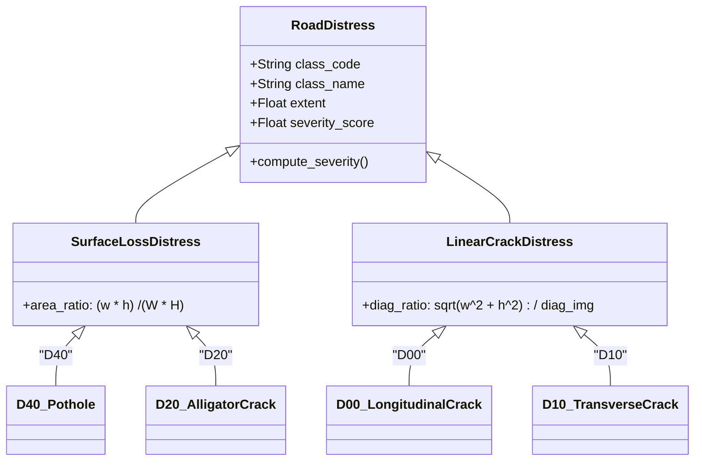

# Civil Engineering Severity Grading & Maintenance Prioritization

## 1. Pavement Distress Classification in Indian Road Conditions

Road condition assessment in India is governed by standards established by the **Indian Roads Congress (IRC)**, specifically:
- **IRC:SP:16** — *Guidelines for Surface Evaluation of Pavements*
- **IRC:82** — *Code of Practice for Maintenance of Bituminous Surfaces of Highways*
- **MoRTH** — *Specifications for Road and Bridge Works*

Traditional manual visual road surveys (e.g., walking inspectors or visual ratings from slow-moving vehicles) are subjective, hazardous, and slow. `rdai` operationalizes the 4 distress classes defined in the RDD benchmark:



1. **`D40` — Potholes:** Localized bowl-shaped depressions extending into the binder or base course. Caused by moisture entrapment, heavy axle loading, and weak asphalt compaction. Represents the highest safety hazard for two-wheelers and passenger vehicles.
2. **`D20` — Alligator (Fatigue) Cracking:** A series of interconnected polygonal fractures resembling crocodile skin. Signifies structural failure of the underlying granular base or subgrade under repetitive traffic loading. Pavement with alligator cracking inevitably develops severe pothole clusters during monsoonal rains.
3. **`D00` — Longitudinal Cracking:** Linear fractures aligned parallel to the centerline of the road. Typically caused by lane joint slippage, wheelpath fatigue, or thermal shrinkage.
4. **`D10` — Transverse Cracking:** Linear fractures perpendicular to the traffic flow. Arise from subgrade thermal expansion/contraction or reflection cracking from underlying cementitious bases.

---

## 2. Mathematical Formulation: 2D Geometric Extent Proxy

Direct physical depth and metric volume measurements require multi-laser profilers or LiDAR equipment costing upwards of ₹50,000,000 ($600,000 USD), which Indian municipal corporations cannot deploy at city scale.

`rdai` uses a calibrated **2D geometric proxy** from standard smartphone and dashcam imagery:

### 2.1. Surface Area Proxy ($e_{\text{area}}$)
For surface defects where the total 2D planar footprint drives damage severity:
$$e_{\text{area}} = \frac{w_{\text{box}} \cdot h_{\text{box}}}{W_{\text{frame}} \cdot H_{\text{frame}}}$$
Where $w_{\text{box}}, h_{\text{box}}$ are bounding box dimensions and $W_{\text{frame}}, H_{\text{frame}}$ are the full image dimensions.

### 2.2. Linear Diagonal Ratio Proxy ($e_{\text{diag}}$)
For cracks, area ratio is inappropriate because a long, hairline crack has high linear span but negligible box area. Severity is governed by the normalized diagonal length:
$$e_{\text{diag}} = \frac{\sqrt{w_{\text{box}}^2 + h_{\text{box}}^2}}{\sqrt{W_{\text{frame}}^2 + H_{\text{frame}}^2}}$$

### 2.3. Calibrated Engineering Bounds (`configs/severity.yaml`)

```yaml
classes:
  D40: # Pothole
    measure: area_ratio
    e_low: 0.015       # 1.5% of field of view
    e_high: 0.050      # 5.0% of field of view
    min_label: Low
  D20: # Alligator Crack
    measure: area_ratio
    e_low: 0.030       # 3.0% of field of view
    e_high: 0.100      # 10.0% of field of view
    min_label: Medium  # Structural failure constraint
  D00: # Longitudinal Crack
    measure: diag_ratio
    e_low: 0.150       # 15% of frame diagonal
    e_high: 0.350       # 35% of frame diagonal
    min_label: Low
  D10: # Transverse Crack
    measure: diag_ratio
    e_low: 0.150       # 15% of frame diagonal
    e_high: 0.350       # 35% of frame diagonal
    min_label: Low
```

### 2.4. Piece-Wise Continuous Score Mapping ($0 - 100$)
To avoid abrupt score cliffs while enforcing standard IRC severity tiers, the normalized extent $e$ maps continuously into $[0.0, 100.0]$:

$$S(e) = \begin{cases} 
\frac{e}{e_{\text{low}}} \times 33.33, & e \le e_{\text{low}} \\
33.33 + \frac{e - e_{\text{low}}}{e_{\text{high}} - e_{\text{low}}} \times 33.34, & e_{\text{low}} < e \le e_{\text{high}} \\
66.67 + \min\left(1.0, \frac{e - e_{\text{high}}}{e_{\text{high}}}\right) \times 33.33, & e > e_{\text{high}}
\end{cases}$$

- **Tiers:**
  - **Low:** $S < 33.33$
  - **Medium:** $33.33 \le S < 66.67$
  - **High:** $S \ge 66.67$
- **Alligator Cracking Safety Constraint:** Any detected `D20` instance has a hard floor of $S \ge 33.33$ (`Medium`), ensuring structural pavement fatigue is never dismissed as minor surface distress.

---

## 3. Spatial Intelligence: 25-Meter Haversine DBSCAN Clustering

Road maintenance contracts and hot-mix patching crews operate on discrete road segments rather than single coordinates. `rdai` clusters individual detections using **Haversine DBSCAN** (`src/rdai/geo/clustering.py`):

1. **Haversine Formula:**
   For any two coordinate pairs $(\phi_1, \lambda_1)$ and $(\phi_2, \lambda_2)$:
   $$d = 2 R \arcsin \left(\sqrt{\sin^2\left(\frac{\Delta \phi}{2}\right) + \cos \phi_1 \cos \phi_2 \sin^2\left(\frac{\Delta \lambda}{2}\right)}\right)$$
   where $R = 6,371,000\text{ meters}$.
2. **Parameters (`configs/priority.yaml`):**
   - $\varepsilon = 25.0\text{ meters}$ (the radius of one standard municipal patch repair block).
   - $\text{min\_samples} = 1$ (every isolated defect is treated as an actionable segment).
3. **Centroid Position:**
   The segment location is the geographic mean of all member detections:
   $$\bar{\phi} = \frac{1}{N} \sum_{i=1}^N \phi_i, \quad \bar{\lambda} = \frac{1}{N} \sum_{i=1}^N \lambda_i$$

---

## 4. Maintenance Prioritization Formula

Road maintenance budgets are strictly finite. Municipal authorities cannot repair all potholes simultaneously. They require a priority formula that balances damage severity, defect concentration, traffic throughput, and AI confidence.

`rdai` formulates priority $P \in [0, 100]$ as an explainable, linear four-term ledger:

$$\mathbf{P = w_1 S_{\max} + w_2 D + w_3 R + w_4 C}$$

Substituting values from `configs/priority.yaml`:

$$\mathbf{P = 0.45 \, S_{\max} + 0.25 \, D + 0.20 \, R + 0.10 \, C}$$

```
   ┌───────────────────────────────────────────────────────────────┐
   │             4-TERM PRIORITY LEDGER BREAKDOWN                  │
   ├───────────────────────────────┬─────────┬─────────────────────┤
   │ Component                     │ Weight  │ Max Contribution    │
   ├───────────────────────────────┼─────────┼─────────────────────┤
   │ Worst Defect Severity (S_max) │  0.45   │      45.0 pts       │
   │ Defect Density (D)            │  0.25   │      25.0 pts       │
   │ Road Network Class (R)        │  0.20   │      20.0 pts       │
   │ Model Detection Conf (C)      │  0.10   │      10.0 pts       │
   ├───────────────────────────────┼─────────┼─────────────────────┤
   │ Total Maximum Priority Score  │  1.00   │     100.0 pts       │
   └───────────────────────────────┴─────────┴─────────────────────┘
```

### 4.1. Term 1: Worst Defect Severity ($S_{\max}$, Weight $0.45$)
$$S_{\max} = \max_{i \in \text{segment}} S_i$$
- **Engineering Rationale:** A road segment containing ten small cracks is dangerous, but a road segment with even one deep 80-score pothole will blow tires and throw two-wheelers. The single worst defect must dominate the ranking.

### 4.2. Term 2: Defect Density ($D$, Weight $0.25$)
$$D = 100 \times \min\left(\frac{N_{\text{unique}}}{10}, 1.0\right)$$
- **Engineering Rationale:** Multiple defects clustered within $25\text{ meters}$ signify localized subgrade collapse. Density scales linearly from $0$ up to $10\text{ defects}$, where it reaches full saturation ($100$ points).

### 4.3. Term 3: OpenStreetMap Road Importance ($R$, Weight $0.20$)
Resolved via live Overpass API query within a 30m radius of the cluster centroid:
- **`motorway` / `trunk` ($R = 100$):** National Highways (NHAI) with high-speed heavy commercial traffic.
- **`primary` ($R = 85$):** State Highways connecting major districts.
- **`secondary` ($R = 70$):** Major District Roads (MDR).
- **`tertiary` ($R = 55$):** Other District Roads (ODR).
- **`residential` / `unclassified` ($R = 35$):** Low-speed colony lanes.
- **`unknown` ($R = 50$):** Fallback when offline or outside mapped ways.

### 4.4. Term 4: AI Model Confidence ($C$, Weight $0.10$)
$$C = 100 \times \left(\frac{1}{N} \sum_{i=1}^N c_i\right)$$
- **Engineering Rationale:** High-confidence detections ($c > 0.85$) represent crisp, unmistakable defects, earning a modest tie-breaking boost over borderline detections ($c \approx 0.20$).

---

## 5. Weight Sensitivity Analysis & Rank Stability

To verify that the prioritization formula does not arbitrarily scramble repair queues under slight administrative policy changes, the weights were perturbed by $\pm 20\%$ across the entire benchmark dataset (`reports/tables/weight_sensitivity.json`).

The ranking stability was measured using the **Spearman Rank Correlation Coefficient ($\rho$)**:

| Perturbation Condition | Adjusted Weights $(w_1, w_2, w_3, w_4)$ | Spearman $\rho$ vs Baseline |
| :--- | :--- | :---: |
| **$S_{\max} +20\%$** | $(0.4954, 0.2294, 0.1835, 0.0917)$ | **`1.000`** |
| **$S_{\max} -20\%$** | $(0.3956, 0.2747, 0.2198, 0.1099)$ | **`1.000`** |
| **$D +20\%$** | $(0.4286, 0.2857, 0.1905, 0.0952)$ | **`1.000`** |
| **$D -20\%$** | $(0.4737, 0.2105, 0.2105, 0.1053)$ | **`1.000`** |
| **$R +20\%$** | $(0.4327, 0.2404, 0.2308, 0.0962)$ | **`1.000`** |
| **$R -20\%$** | $(0.4688, 0.2604, 0.1667, 0.1042)$ | **`1.000`** |
| **$C +20\%$** | $(0.4412, 0.2451, 0.1961, 0.1176)$ | **`1.000`** |
| **$C -20\%$** | $(0.4592, 0.2551, 0.2041, 0.0816)$ | **`1.000`** |

**Conclusion:** The priority ranking is exceptionally stable ($\rho = 1.0$), ensuring that municipal crews receive a consistent, non-volatile triage order regardless of minor administrative weight adjustments.
